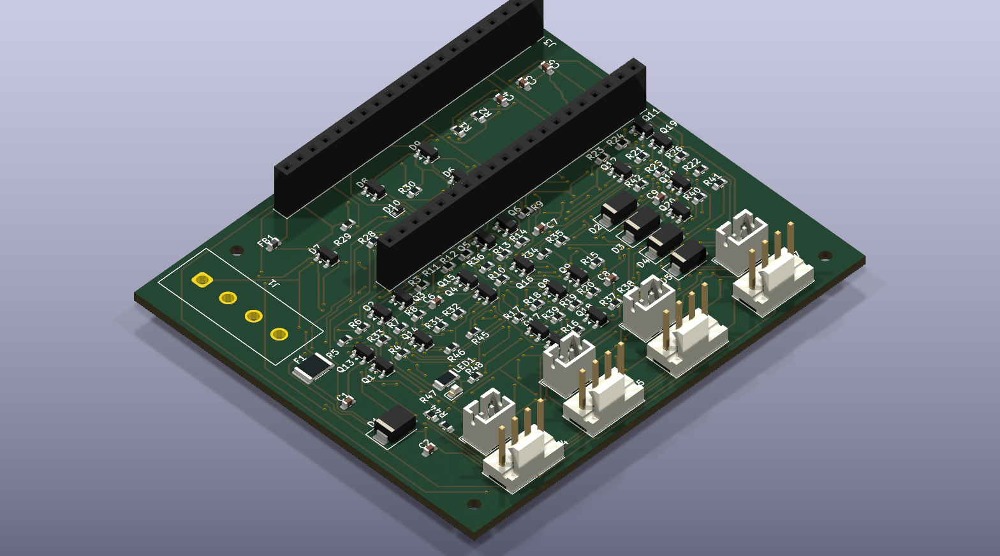
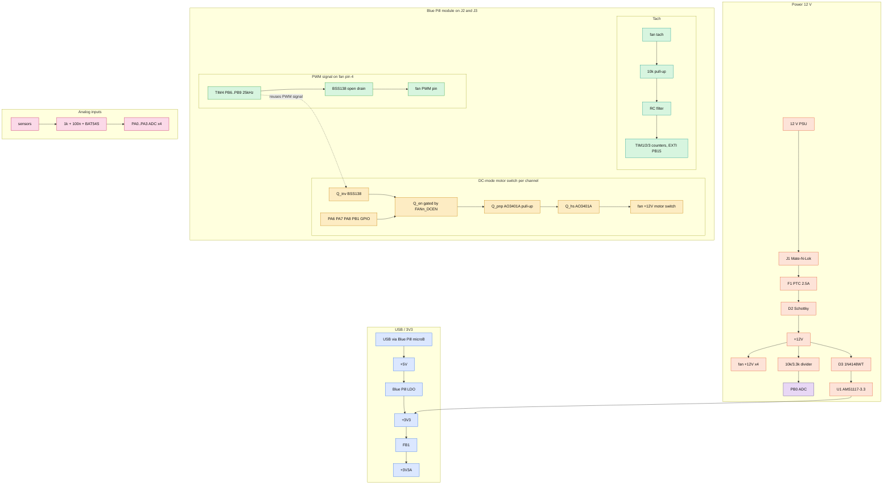
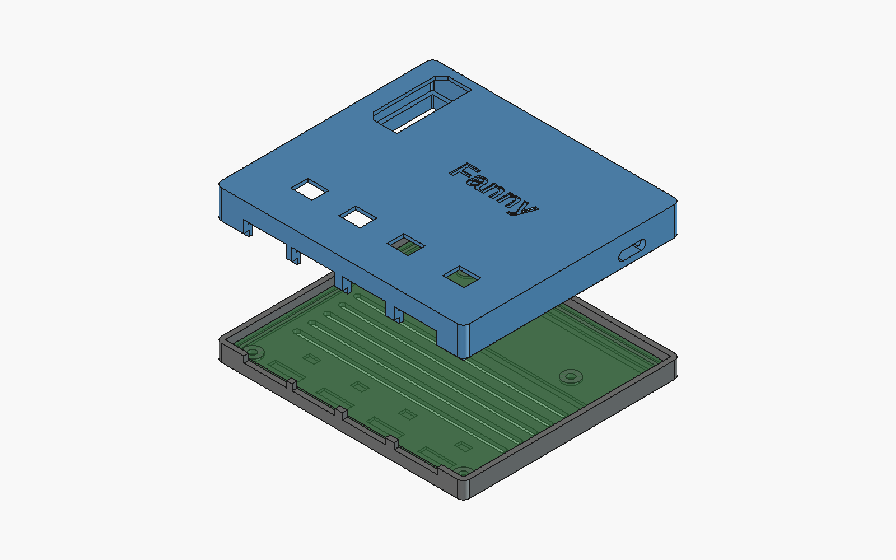

# Fanny — a USB PWM fan controller



A USB-controlled carrier board for an STM32F103C8T6 "Blue Pill" module. It
drives four 12 V PC fans and reads four analog sensors. The module shows up
on the host as a USB CDC serial port (`/dev/ttyACM*` or `COMx`).

## Key features

- **4 independent fan channels.** Each one switches between `pwm` (4-pin
  signal control) and `dc` (3-pin supply chopping) at runtime.
- **4 analog inputs** for NTC or voltage sensors plus 12 V rail sensing. All
  share one ADC scan with mV conversion.
- **Tach and stall detection** on all 4 channels. Fans 1-3 are counted by
  hardware timers, fan 4 by a level-checked interrupt.
- **Hardware failsafe by design.** Every control line rests in its "fan on"
  state by default, held there by pull resistors alone. A fan runs at
  100% on power-up, after a crash, or with the MCU pulled out. No firmware
  or host required.
- **Text protocol over USB CDC.** Comes with a Python CLI (`fanctl.py`) and
  a daemon (`fancontrold.py`) for temperature or GPU-temperature curves.

## Repository structure

```
.
├── firmware/          MCU firmware
│   ├── Core/          clocks, SysTick, linker script, board pin map
│   ├── Drivers/       libopencm3 submodule
│   ├── USB_DEVICE/    USB CDC-ACM device
│   ├── App/           fan, pwm, tach, protocol, thermal, safety
│   └── tests/         host-side unit tests
├── hardware/
│   ├── kicad/         schematic, symbol lib, board
│   ├── case/          3D-printed tray and cover (FreeCAD script, STEP, STL, renders)
│   ├── bom.csv        bill of materials
│   ├── pcb_3d.png     3D render of the placed board
│   ├── pcb_top.png    placement plot seen from the top
│   └── datasheets/    links to the key datasheets
└── host/              fanctl.py command-line client (pyserial)
```

## Prerequisites

KiCad 10.0.7, arm-none-eabi-gcc, OpenOCD, and Python 3 with pyserial:

```sh
# Arch
sudo pacman -S kicad arm-none-eabi-gcc arm-none-eabi-newlib openocd python python-pyserial

# Ubuntu 24.04
sudo add-apt-repository ppa:kicad/kicad-10.0-releases
sudo apt update
sudo apt install kicad gcc-arm-none-eabi openocd python3 python3-serial
```

You also need an ST-Link V2 programmer wired to the Blue Pill's SWD header
to flash firmware. FreeCAD 1.1 is only needed to change the printed case.

`make analyze` (clang static analyzer over the firmware, see Build below)
needs clang-23 specifically; a different major version can enable a
different default set of checkers, which has produced false positives on
this codebase before.

```sh
# Arch: clang already provides a clang-23 symlink, nothing extra to install
sudo pacman -S clang

# Ubuntu 24.04: its own archives don't carry clang-23, so use the LLVM
# project's own installer instead
wget https://apt.llvm.org/llvm.sh
chmod +x llvm.sh
sudo ./llvm.sh 23
```


## Hardware design

### Block overview



### Pin map

| Function | Pins | Peripheral |
|---|---|---|
| Fan 1–4 PWM signal and the motor-switch chop signal in DC mode | PB6 PB7 PB8 PB9 | TIM4 CH1–4 at 25 kHz |
| Fan 1–4 DC-mode enable | PA6 PA7 PA8 PB1 | plain push-pull GPIO |
| Fan 1–3 tach | PA9 PA15 PB5 | TIM1 CH2, TIM2 CH1 (partial remap 1), TIM3 CH2 (partial remap), each in external clock mode counting falling edges in hardware |
| Fan 4 tach | PB15 | EXTI15 on both edges, counted only on a real high-to-low level change |
| AIN1–AIN4 | PA0–PA3 | ADC1 IN0–IN3 |
| 12 V sense | PB0 | ADC1 IN8 |

### Compatibility

Verified against the [Intel 4-wire PWM fan spec rev 1.2](https://www.konilabs.net/docs/standards/fan/intel_4wire_pwm_fans_specs_rev1_2.pdf):

| Spec requirement | Board implementation | Status |
|---|---|---|
| Pinout of GND then +12 V then tach then PWM | `Fan_4pin` header wired in that order | Match |
| PWM must be open-drain or open-collector with the fan pulling up | BSS138 open-drain transistor where the MCU only sinks | Match |
| PWM frequency between 21 kHz and 28 kHz with 25 kHz nominal | TIM4 at 72 MHz / 2880 which is exactly 25.000 kHz | Match |
| A released PWM line must run the fan at full speed | 100 kΩ pull-down holds the transistor off until firmware drives it | Match |
| Tach must be open-collector and pulled up at 2 pulses per rev | 10 kΩ pull-up to 3.3 V with `TACH_PULSES_PER_REV = 2` in firmware | Match |
| Tach pull-up rail of 5 V or less into a tolerant input | Pulled to 3.3 V. PA9, PA15 and PB15 are 5 V tolerant; PB5 is not, so fan 3 needs the 3.3 V pull-up | Match |

### Analog inputs (AIN1–AIN4)

Each input is a 3-pin header carrying 3V3A and SIG and GND. The conditioning
chain works like this:

- A 10 kΩ pull-up to 3V3A. Together with a 10 kΩ NTC to GND it forms a
  ratiometric temperature divider. Leave it unfitted for voltage-output
  sensors.
- A 1 kΩ series resistor and 100 nF to GND for anti-aliasing and sample
  charge.
- A BAT54S clamp to GND and 3V3A. PA0–PA3 are **not** 5 V tolerant.

The ADC references VDDA. The firmware measures VREFINT so it can report
millivolts corrected for the actual supply voltage.

#### Choosing an NTC

The on-board pull-up is 10 kΩ, matched to a 10 kΩ NTC with B=3950 (`ntc_r25 =
10000`, `ntc_beta = 3950` in the fan daemon config, both already the
defaults). Any bare 2-wire 10 kΩ/B3950 probe plugs straight in, SIG and GND,
no third wire needed — this is what the probe bundled with the
[Skip0ner 1X4L fan-1248 conf v1](https://skiponer.com/1x4l-pwm-fan-controller-manual/)
module is. Expected mV at a given temperature:
`hardware/datasheets/NTC-10k-B3950 Response Curve.md`, taken from the
10k/3950 column of Focusensing's
[10k thermistor reference chart](https://www.focusensing.com/10k-thermistor-chart-type-2-vs-type-3-vs-3950-tables_n196).
The onboard autocurve mode (`auto on`) uses the same table, baked into
`firmware/App/ntc_calib.h`. The firmware saves `auto on` or `auto off` to
flash with the curves, so a board that reboots without a host comes back in
the same mode.

A different R25 needs a matching pull-up swap, since the pull-up sets both
the divider's output range and the firmware's calibration constant: match
`ntc_r25` (host) and `ntc_calib_ain1..4` (firmware) to the new part's R25 and
B, and re-check `fanctl.py get`'s `ain N mv` against a known temperature
before trusting the curve.

### Power

- **12 V input:** a screw terminal, a PTC that holds 2.5 A, then an SS54
  Schottky diode (anode toward the PTC) that blocks a reversed supply instead
  of tripping the PTC. The PTC resets on its own, so a miswire leaves nothing
  to replace.
- **Module supply:** USB, 12 V, or both. The LDO on the Blue Pill makes
  3.3 V from USB VBUS. U1 (AMS1117-3.3) on the carrier makes 3.3 V from the
  12 V bus and feeds the module 3V3 pin, so the board runs with no USB cable.
  With both present, whichever regulator sits a little higher carries the
  load. D3 sits in front of U1 so that a USB-only board doesn't back-feed
  3.3 V onto the 12 V bus through U1.
- **12 V monitoring:** a 10 kΩ/3.3 kΩ divider into PB0. Full scale lands near
  13.3 V, so a supply above that reads as 13.3 V.
- **USB:** the micro-B connector of the Blue Pill and nothing else. The
  carrier has no USB connector or header or ESD protection of its own. The
  firmware pulls D+ low for 10 ms at boot to force the host to re-enumerate.

## BOM list

The full bill of materials is in [`hardware/bom.csv`](hardware/bom.csv).

## Case



[`hardware/case/`](hardware/case/) holds a two-part printed case: a low tray
and a cover. Both parts print without supports and weigh about 33 g together
in PLA.

The PCB screws onto four standoffs in the tray with M2x6 self-tapping screws.
Fit the MH4 screw before you plug in the Blue Pill, because the module covers
it. The tray wall stands 2 mm above the board, so the tray works on its own
too.

The cover sits on the tray wall, and a lip inside the wall holds it by
friction. Each fan header gets a window wide enough for a finger on the plug
latch. More windows sit over the sensor inputs, the 12 V input and the Blue
Pill SWD pins, and a notch in the side leaves room for the USB plug.

All sizes are constants at the top of `fan_controller_case.py`. After you
change one, rebuild the FreeCAD document, the STEP files and the STLs:

```sh
cd hardware/case
freecadcmd fan_controller_case.py
```

Run `freecad fan_controller_case.py` instead to also redraw the two images
above. The FreeCAD window opens for a few seconds and closes on its own.

The cover underside sits 20 mm above the PCB. That figure comes from an
estimated 18.6 mm Blue Pill stack with the BOOT jumpers fitted, so measure
your module and raise `TOP_CLEAR` if it stands taller.

## Firmware

### Build

```sh
git clone --recurse-submodules git@github.com:rmskkn/fanny.git
cd fanny
make                 # firmware/build/fanny.elf, .bin (~11.5 KiB flash)
make flash           # flash fanny.bin, OpenOCD + ST-Link over SWD
make test            # host-side protocol and conversion tests
make analyze         # clang static analyzer over the firmware sources
```

The first `make` builds libopencm3 for STM32F1 only. It also runs
`git submodule update --init` when the clone has no submodule checkout. The
same targets work from inside `firmware/`.

`make flash` wraps this OpenOCD call, with an ST-Link programmer on the
Blue Pill's SWD header. `fanny.bin` is a raw image with no load address, so
one is given on the command line, the start of flash on this MCU:

```sh
openocd -f interface/stlink.cfg -f target/stm32f1x.cfg \
    -c "program firmware/build/fanny.bin verify reset exit 0x08000000"
```

`fanny.elf` still builds alongside it (`make` keeps producing both), kept
for `arm-none-eabi-size` and debugging, but flashing only ever needs the bin.

### Failsafe behaviour

All fans run at 100 % whenever the controller is not in control and that holds
in both `pwm` and `dc` mode. Fan power comes straight from 12 V so this needs
nothing but 12 V present. The PWM signal line and the motor switch and the
DC-mode enable all rest in their "fan on" state. Pin 4 is released and
`R_gpd` holds the motor switch on and `R_dcen` holds the enable off. Either
mode reaches 100 % the same way.

| Case | Result |
|---|---|
| Power-up before the first command from the host, `auto off` saved | 100 % at reset, then the curve fallback below within 1 s |
| Power-up with `auto on` saved | Each fan follows its temperature curve from boot, with or without a host |
| USB unplugged or host powered off, `auto on` | Module stays powered from 12 V through U1 and keeps driving each fan from its temperature curve |
| USB unplugged or host powered off, `auto off` | Module stays powered from 12 V through U1, gets no commands, and after 20 s falls back to the curves as in the last row |
| Module pulled out of its socket | Both switches rest on at 100 % |
| Supply sags below the reset threshold of the STM32 near 1.9 V | MCU held in reset and both switches rest on at 100 % |
| Firmware hangs | Watchdog resets the MCU after 1 s and both switches rest on during reset at 100 % |
| No valid command for 20 s while the module is still powered and `auto off` | Firmware failsafe sets 100 %, the LED blinks fast and the mode stays unchanged. Within 1 s each fan falls back to its saved curve. A channel with no curve or a bad sensor stays at 100 %, and a corrupted curve on any channel keeps every fan at 100 %. The next valid command hands control back to the host |

Running `fanctl.py watch` or a control daemon keeps the 20 s timer from
expiring. A fan is flagged `stall=1` when its duty sits above 0 but its tach
reads 0 RPM for 3 s. Fans without a tach wire always show this flag.

### Host commands

The protocol is text over USB CDC and the baud rate is ignored. Each command
is one line ending in `\n` and each reply ends with `ok` or `err <reason>`.

```
> set 2 40          duty 0..100 for fan 1..4 or "all"
ok
> mode 3 dc         pwm (4-pin) | dc (3-pin)
ok
> get
fan 1 mode=pwm duty=100 rpm=1590 stall=0
fan 2 mode=pwm duty=40 rpm=780 stall=0
fan 3 mode=dc duty=100 rpm=1200 stall=0
fan 4 mode=pwm duty=100 rpm=0 stall=1
ain 1 raw=2047 mv=1649
...
v12 mv=12043
vdda mv=3302
mcu temp=31.4
failsafe=0
ok
> ping              keepalive
ok
```

## Host tool

```sh
pip install -r host/requirements.txt
python3 host/fanctl.py -p /dev/ttyACM0 get
python3 host/fanctl.py set all 50
python3 host/fanctl.py mode 3 dc
python3 host/fanctl.py watch -i 2
```

### Setting one fan

Use the fan number from 1 to 4 in place of `all`. Fan 1 is header J5 and fan
4 is header J8.

```sh
python3 host/fanctl.py set 1 50      # fan 1 to 50 %
python3 host/fanctl.py set 3 80      # fan 3 to 80 %
python3 host/fanctl.py set 4 0       # fan 4 to 0 % (some fans keep turning slowly)
python3 host/fanctl.py -p /dev/ttyACM1 set 2 40   # board on another port
```

- Each command sets one fan or all fans. Lists such as `1,2` and ranges such
  as `1-3` are not accepted.
- To check a fan run `python3 host/fanctl.py get` and read the
  `fan N mode=... duty=... rpm=...` line.
- With `auto off`, settings hold only while the host keeps talking to the
  board. When no command arrives for 20 s the fans fall back to the saved
  curves, or 100 % without them. Keep `fanctl.py watch` or a control daemon
  running to hold the values.
- `mode <1-4|all> pwm|dc` picks the speed-control path for a channel: `pwm`
  for a 4-pin fan, `dc` for a 3-pin fan. It falls back to `pwm` at every
  boot and after every reconnect so the channel of a 3-pin fan needs
  `mode N dc` sent again each time.

The `FanController` class in `fanctl.py` can be imported to build a control
daemon. One example is a daemon that maps an NTC reading from `ain` onto a fan
duty. For a 10 kΩ NTC sitting on the 10 kΩ bias resistor the resistance is
R<sub>NTC</sub> = 10 kΩ × mV / (VDDA − mV).

### Fan control daemon

`host/fancontrold.py` is exactly that daemon. It reads an INI config shown in
`host/fancontrol.conf.example`. The config can set each of the four channels
to a constant duty or to a temperature curve driven by one AIN input or to a
curve driven by the temperature of an NVIDIA GPU through `sensor = gpuN` read
via `nvidia-smi` using the higher of the core and memory temperature. A
managed channel also takes `type = pwm` for the 4-pin default or `type = dc`
for a 3-pin fan. The daemon sends `mode` once at startup and again after every
reconnect because a firmware reset returns every channel to `pwm`. It sends
`auto off` at the same points, because the board ignores `set` while `auto on`
runs. Stopping the daemon leaves the board in `auto off`, so run
`fanctl.py auto on` to hand control back to the board. Every cycle
it re-sends the duty of each managed channel which doubles as the ping that
holds off the 20 s firmware failsafe. A channel with no `[fanN]` section is
left alone. `nvidia-smi` must be on `PATH` and no extra Python dependency is
needed.

For a `gpuN` sensor install the proprietary NVIDIA driver which provides
`nvidia-smi`:

```sh
# Arch
sudo pacman -S nvidia nvidia-utils

# Ubuntu 24.04
sudo apt install nvidia-driver-550
```

Reboot the machine to load the nvidia modules. Verify with
`nvidia-smi --query-gpu=index,temperature.gpu,temperature.memory --format=csv`.

```sh
cp host/fancontrol.conf.example ~/.config/fancontrol.conf
# edit ~/.config/fancontrol.conf for your sensors and curves
python3 host/fancontrold.py                 # foreground, Ctrl-C to stop
```

To run it as a systemd user service:

```sh
mkdir -p ~/.config/systemd/user
cp host/systemd/fancontrold.service ~/.config/systemd/user/
# edit ExecStart in that file to this repo's checkout path
systemctl --user daemon-reload
systemctl --user enable --now fancontrold.service
loginctl enable-linger "$USER"   # only if the board must run with no user session logged in
```

### Updating firmware via USB

A fresh board's first flash still needs SWD: `make ota_fw` builds the
bootloader and app, `make flash_ota` writes the app part at its fixed
address (the bootloader itself has no `make` target yet, so it still
needs its own manual OpenOCD `program` command). From there, every
later update goes over the same USB CDC link, no SWD needed.

```sh
python3 host/fwtool.py flash firmware/build/fanny_app.bin -v 2
```

This sends `update` to the running app, which reboots into the bootloader.
The bootloader erases the app region, writes the new image, checks its
SHA-256, and boots it. `-v` sets the version number sealed into the image;
bump it on every release. To build the sealed image without flashing it:

```sh
python3 host/fwtool.py build firmware/build/fanny_app.bin -v 2 -o update.img
```

The image format `fwtool.py` builds, and the bootloader checks, comes from
the `firmware/Bootloader/chunky` submodule
([rmskkn/chunky_mcu_updater](https://github.com/rmskkn/chunky_mcu_updater)).

## Known limits

- **0 % doesn't stop every 4-pin fan in `pwm` mode** (fan-dependent). It does
  stop the fan in `dc` mode.
- **Duty 1-100 % maps to 10-100 % on the PWM line.** A Noctua NF-P12 PWM
  won't start below 10 % and stops below about 6 % even after a spin-up, so
  the firmware never sends less than 10 % unless you set 0 %. At 1 % that fan
  runs at about 200 rpm. Every other setting lands a little above its raw
  value: 50 % sends 55 %.
- **3-pin fans in `dc` mode won't start below ~30-40 % duty** (motor limit,
  not firmware). Set a curve minimum above it.
- **Fan 4 tach uses an interrupt, not a hardware counter.** Each counter
  needs a whole timer, and the STM32F103C8 has four: TIM1-TIM3 count fans
  1-3 and TIM4 makes the PWM. Fan 4 runs on EXTI15 with a pin-level check
  that ignores spikes shorter than the interrupt entry time (about 0.5 us).
  Longer glitches still count, and edges closer together than the handler
  runtime can merge.
- **JTAG is off** because fan 2 tach uses PA15. SWD on PA13/PA14 still
  flashes and debugs the board.
- **Tach under-reads in `dc` mode** since the fan is unpowered during the
  chopped-off phase. `stall` is only meaningful near 100 % duty.
- **25 kHz chop stresses a fan's input cap** but stays inaudible. All four
  `pwm` channels share one chop frequency.

## Special thanks

These open-source projects helped build the project:

1. [KiCAD-MCP-Server](https://github.com/mixelpixx/KiCAD-MCP-Server) by
   mixelpixx drives KiCad schematic and PCB edits over MCP.
2. [freecad-mcp](https://github.com/neka-nat/freecad-mcp) by neka-nat drives
   FreeCAD over MCP for the printed case.
3. [KiCadRoutingTools](https://github.com/drandyhaas/KiCadRoutingTools) by
   drandyhaas reroutes nets that fail DRC.

## License

Copyright © 2026 Roman Skakun.

The hardware and the code use different licenses.

The hardware design files in `hardware/` (KiCad project, BOM, renders, and
the case model files) are licensed under
[Creative Commons Attribution-NonCommercial-ShareAlike 4.0 International](LICENSE)
(CC BY-NC-SA 4.0). You may build, modify and share the design for personal
and other non-commercial purposes, with attribution and under the same
license. Commercial use needs a separate written license from the copyright
holder. That includes selling assembled boards, bare PCBs or kits.

The 3D models in `hardware/kicad/3dmodels/` are copied from the KiCad
library and keep their own CC-BY-SA 4.0 license with the KiCad libraries
exception. See [`hardware/kicad/3dmodels/README.md`](hardware/kicad/3dmodels/README.md).

The code in `firmware/`, `host/`, `scripts/`, `hardware/scripts/` and the
case generator `hardware/case/fan_controller_case.py` is licensed under the [GNU General Public License v3.0](LICENSE-GPL-3.0). You
may use, change and redistribute it, including commercially, as long as you
release the source of every version you distribute under the same license.

`firmware/Drivers/libopencm3` is a submodule under its own LGPL-3.0 license
and is covered by neither of the above.
