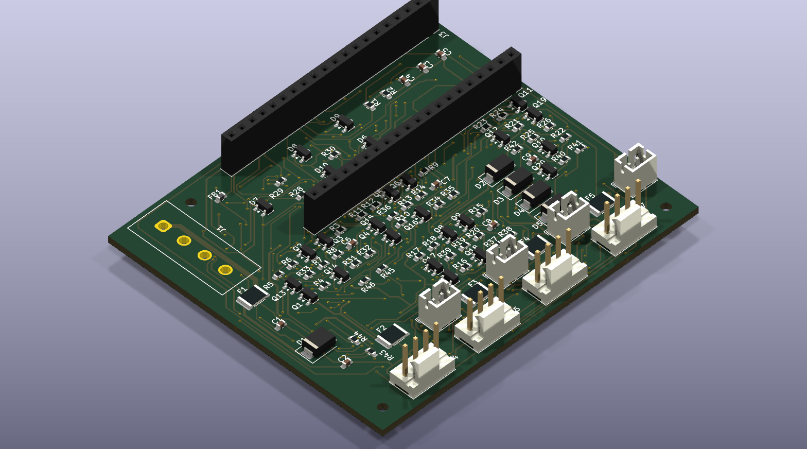
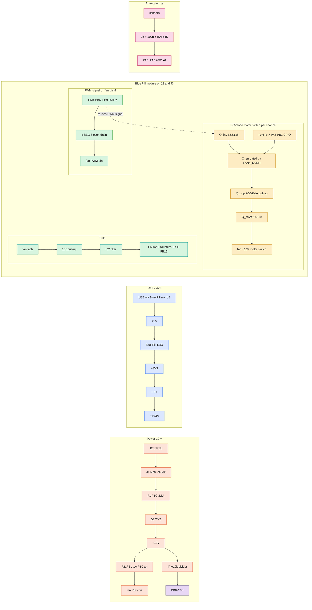

# Fanny — a USB PWM fan controller



A USB-controlled carrier board for an STM32F103C8T6 "Blue Pill" module. It
drives four 12 V PC fans and reads four analog sensors. The module shows up
on the host as a USB CDC serial port (`/dev/ttyACM*` or `COMx`).

## Key features

- **4 independent fan channels.** Each one switches between `pwm` (4-pin
  signal control) and `dc` (3-pin supply chopping) at runtime.
- **4 analog inputs** for NTC or voltage sensors plus 12 V rail sensing. All
  share one ADC scan with mV conversion.
- **Tach and stall detection** on all 4 channels. Fans 1-3 are counted by
  hardware timers, fan 4 by a level-checked interrupt.
- **Hardware failsafe by design.** Every control line rests in its "fan on"
  state by default, held there by pull resistors alone. A fan runs at
  100% on power-up, after a crash, or with the MCU pulled out. No firmware
  or host required.
- **Per-channel and board-level PTC fusing** plus a 12 V TVS.
- **Text protocol over USB CDC.** Comes with a Python CLI (`fanctl.py`) and
  a daemon (`fancontrold.py`) for temperature or GPU-temperature curves.

## Repository structure

```
.
├── firmware/          MCU firmware
│   ├── Core/          clocks, SysTick, linker script, board pin map
│   ├── Drivers/       libopencm3 submodule
│   ├── USB_DEVICE/    USB CDC-ACM device
│   ├── App/           fan, pwm, tach, protocol, thermal, safety
│   └── tests/         host-side unit tests
├── hardware/
│   ├── kicad/         schematic, symbol lib, board
│   ├── bom.csv        bill of materials
│   ├── pcb_3d.png     3D render of the placed board
│   ├── pcb_top.png    placement plot seen from the top
│   └── datasheets/    links to the key datasheets
└── host/              fanctl.py command-line client (pyserial)
```

## Prerequisites

KiCad 10.0.7, arm-none-eabi-gcc, OpenOCD, and Python 3 with pyserial:

```sh
# Arch
sudo pacman -S kicad arm-none-eabi-gcc arm-none-eabi-newlib openocd python python-pyserial

# Ubuntu 24.04
sudo add-apt-repository ppa:kicad/kicad-10.0-releases
sudo apt update
sudo apt install kicad gcc-arm-none-eabi openocd python3 python3-serial
```

You also need an ST-Link V2 programmer wired to the Blue Pill's SWD header
to flash firmware.


## Hardware design

### Block overview



### Pin map

| Function | Pins | Peripheral |
|---|---|---|
| Fan 1–4 PWM signal and the motor-switch chop signal in DC mode | PB6 PB7 PB8 PB9 | TIM4 CH1–4 at 25 kHz |
| Fan 1–4 DC-mode enable | PA6 PA7 PA8 PB1 | plain push-pull GPIO |
| Fan 1–3 tach | PA9 PA15 PB5 | TIM1 CH2, TIM2 CH1 (partial remap 1), TIM3 CH2 (partial remap), each in external clock mode counting falling edges in hardware |
| Fan 4 tach | PB15 | EXTI15 on both edges, counted only on a real high-to-low level change |
| AIN1–AIN4 | PA0–PA3 | ADC1 IN0–IN3 |
| 12 V sense | PB0 | ADC1 IN8 |

### Compatibility

Verified against the [Intel 4-wire PWM fan spec rev 1.2](https://www.konilabs.net/docs/standards/fan/intel_4wire_pwm_fans_specs_rev1_2.pdf):

| Spec requirement | Board implementation | Status |
|---|---|---|
| Pinout of GND then +12 V then tach then PWM | `Fan_4pin` header wired in that order | Match |
| PWM must be open-drain or open-collector with the fan pulling up | BSS138 open-drain transistor where the MCU only sinks | Match |
| PWM frequency between 21 kHz and 28 kHz with 25 kHz nominal | TIM4 at 72 MHz / 2880 which is exactly 25.000 kHz | Match |
| A released PWM line must run the fan at full speed | 100 kΩ pull-down holds the transistor off until firmware drives it | Match |
| Tach must be open-collector and pulled up at 2 pulses per rev | 10 kΩ pull-up to 3.3 V with `TACH_PULSES_PER_REV = 2` in firmware | Match |
| Tach pull-up rail of 5 V or less into a tolerant input | Pulled to 3.3 V. PA9, PA15 and PB15 are 5 V tolerant; PB5 is not, so fan 3 needs the 3.3 V pull-up | Match |

### Analog inputs (AIN1–AIN4)

Each input is a 3-pin header carrying 3V3A and SIG and GND. The conditioning
chain works like this:

- A 10 kΩ pull-up to 3V3A. Together with a 10 kΩ NTC to GND it forms a
  ratiometric temperature divider. Leave it unfitted for voltage-output
  sensors.
- A 1 kΩ series resistor and 100 nF to GND for anti-aliasing and sample
  charge.
- A BAT54S clamp to GND and 3V3A. PA0–PA3 are **not** 5 V tolerant.

The ADC references VDDA. The firmware measures VREFINT so it can report
millivolts corrected for the actual supply voltage.

#### Example: a 33 kΩ NTC (NTCM-HP-33K-1%)

The default 10 kΩ pull-up is sized for a 10 kΩ NTC. A different R25 needs a
matching pull-up: it sets both the divider's output range and the firmware's
calibration constant.

For an NTCM-HP-33K-1% (33 kΩ, B=3950 K):

1. Swap the on-board pull-up from 10 kΩ to 33 kΩ.
2. In the fan daemon config, set `ntc_r25 = 33000` (the default `ntc_beta =
   3950` already matches this part).
3. Before trusting the curve, compare `fanctl.py get`'s `ain N mv` reading at
   a known temperature against the expected value in
   `hardware/datasheets/NTCM-HP-33K-1_ Response Curve.md`.

### Power

- **12 V input:** a screw terminal followed by a PTC that holds 2.5 A and
  then an SMBJ13A TVS. Reversed polarity makes the TVS conduct and that trips
  the PTC.
- **Module supply:** USB only. The board carries no 5 V or 3.3 V regulator.
  The LDO on the Blue Pill makes 3.3 V from USB VBUS.
- **12 V monitoring:** a 47 kΩ/10 kΩ divider into PB0. Full scale lands near
  18.8 V.
- **USB:** the micro-B connector of the Blue Pill and nothing else. The
  carrier has no USB connector or header or ESD protection of its own. The
  firmware pulls D+ low for 10 ms at boot to force the host to re-enumerate.

## BOM list

The full bill of materials is in [`hardware/bom.csv`](hardware/bom.csv).

## Firmware

### Build

```sh
git clone --recurse-submodules git@github.com:rmskkn/fanny.git
cd fanny
make                 # firmware/build/fanny.elf, .bin (~11.5 KiB flash)
make flash           # flash fanny.bin, OpenOCD + ST-Link over SWD
make test            # host-side protocol and conversion tests
```

The first `make` builds libopencm3 for STM32F1 only. It also runs
`git submodule update --init` when the clone has no submodule checkout. The
same targets work from inside `firmware/`.

`make flash` wraps this OpenOCD call, with an ST-Link programmer on the
Blue Pill's SWD header. `fanny.bin` is a raw image with no load address, so
one is given on the command line, the start of flash on this MCU:

```sh
openocd -f interface/stlink.cfg -f target/stm32f1x.cfg \
    -c "program firmware/build/fanny.bin verify reset exit 0x08000000"
```

`fanny.elf` still builds alongside it (`make` keeps producing both), kept
for `arm-none-eabi-size` and debugging, but flashing only ever needs the bin.

### Failsafe behaviour

All fans run at 100 % whenever the controller is not in control and that holds
in both `pwm` and `dc` mode. Fan power comes straight from 12 V so this needs
nothing but 12 V present. The PWM signal line and the motor switch and the
DC-mode enable all rest in their "fan on" state. Pin 4 is released and
`R_gpd` holds the motor switch on and `R_dcen` holds the enable off. Either
mode reaches 100 % the same way.

| Case | Result |
|---|---|
| Power-up before the first command from the host | 100 % |
| USB unplugged or host powered off | Module unpowered and both switches rest on at 100 % |
| Module pulled out of its socket | Both switches rest on at 100 % |
| Supply sags below the reset threshold of the STM32 near 1.9 V | MCU held in reset and both switches rest on at 100 % |
| Firmware hangs | Watchdog resets the MCU after 1 s and both switches rest on during reset at 100 % |
| No valid command for 10 s while the module is still powered | Firmware failsafe sets 100 % and the LED blinks fast and the mode stays unchanged |

Running `fanctl.py watch` or a control daemon keeps the 10 s timer from
expiring. A fan is flagged `stall=1` when its duty sits above 0 but its tach
reads 0 RPM for 3 s. Fans without a tach wire always show this flag.

### Host commands

The protocol is text over USB CDC and the baud rate is ignored. Each command
is one line ending in `\n` and each reply ends with `ok` or `err <reason>`.

```
> set 2 40          duty 0..100 for fan 1..4 or "all"
ok
> mode 3 dc         pwm (4-pin) | dc (3-pin)
ok
> get
fan 1 mode=pwm duty=100 rpm=1590 stall=0
fan 2 mode=pwm duty=40 rpm=780 stall=0
fan 3 mode=dc duty=100 rpm=1200 stall=0
fan 4 mode=pwm duty=100 rpm=0 stall=1
ain 1 raw=2047 mv=1649
...
v12 mv=12043
vdda mv=3302
mcu temp=31.4
failsafe=0
ok
> ping              keepalive
ok
```

## Host tool

```sh
pip install -r host/requirements.txt
python3 host/fanctl.py -p /dev/ttyACM0 get
python3 host/fanctl.py set all 50
python3 host/fanctl.py mode 3 dc
python3 host/fanctl.py watch -i 2
```

### Setting one fan

Use the fan number from 1 to 4 in place of `all`. Fan 1 is header J5 and fan
4 is header J8.

```sh
python3 host/fanctl.py set 1 50      # fan 1 to 50 %
python3 host/fanctl.py set 3 80      # fan 3 to 80 %
python3 host/fanctl.py set 4 0       # fan 4 to 0 % (some fans keep turning slowly)
python3 host/fanctl.py -p /dev/ttyACM1 set 2 40   # board on another port
```

- Each command sets one fan or all fans. Lists such as `1,2` and ranges such
  as `1-3` are not accepted.
- To check a fan run `python3 host/fanctl.py get` and read the
  `fan N mode=... duty=... rpm=...` line.
- Settings hold only while the host keeps talking to the board. When no
  command arrives for 10 s all fans return to 100 %. Keep `fanctl.py watch`
  or a control daemon running to hold the values.
- `mode <1-4|all> pwm|dc` picks the speed-control path for a channel: `pwm`
  for a 4-pin fan, `dc` for a 3-pin fan. It falls back to `pwm` at every
  boot and after every reconnect so the channel of a 3-pin fan needs
  `mode N dc` sent again each time.

The `FanController` class in `fanctl.py` can be imported to build a control
daemon. One example is a daemon that maps an NTC reading from `ain` onto a fan
duty. For a 10 kΩ NTC sitting on the 10 kΩ bias resistor the resistance is
R<sub>NTC</sub> = 10 kΩ × mV / (VDDA − mV).

### Fan control daemon

`host/fancontrold.py` is exactly that daemon. It reads an INI config shown in
`host/fancontrol.conf.example`. The config can set each of the four channels
to a constant duty or to a temperature curve driven by one AIN input or to a
curve driven by the temperature of an NVIDIA GPU through `sensor = gpuN` read
via `nvidia-smi` using the higher of the core and memory temperature. A
managed channel also takes `type = pwm` for the 4-pin default or `type = dc`
for a 3-pin fan. The daemon sends `mode` once at startup and again after every
reconnect because a firmware reset returns every channel to `pwm`. Every cycle
it re-sends the duty of each managed channel which doubles as the ping that
holds off the 10 s firmware failsafe. A channel with no `[fanN]` section is
left alone. `nvidia-smi` must be on `PATH` and no extra Python dependency is
needed.

For a `gpuN` sensor install the proprietary NVIDIA driver which provides
`nvidia-smi`:

```sh
# Arch
sudo pacman -S nvidia nvidia-utils

# Ubuntu 24.04
sudo apt install nvidia-driver-550
```

Reboot the machine to load the nvidia modules. Verify with
`nvidia-smi --query-gpu=index,temperature.gpu,temperature.memory --format=csv`.

```sh
cp host/fancontrol.conf.example ~/.config/fancontrol.conf
# edit ~/.config/fancontrol.conf for your sensors and curves
python3 host/fancontrold.py                 # foreground, Ctrl-C to stop
```

To run it as a systemd user service:

```sh
mkdir -p ~/.config/systemd/user
cp host/systemd/fancontrold.service ~/.config/systemd/user/
# edit ExecStart in that file to this repo's checkout path
systemctl --user daemon-reload
systemctl --user enable --now fancontrold.service
loginctl enable-linger "$USER"   # only if the board must run with no user session logged in
```

## Known limits

- **0 % doesn't stop every 4-pin fan in `pwm` mode** (fan-dependent). It does
  stop the fan in `dc` mode.
- **Duty 1-100 % maps to 10-100 % on the PWM line.** A Noctua NF-P12 PWM
  won't start below 10 % and stops below about 6 % even after a spin-up, so
  the firmware never sends less than 10 % unless you set 0 %. At 1 % that fan
  runs at about 200 rpm. Every other setting lands a little above its raw
  value: 50 % sends 55 %.
- **3-pin fans in `dc` mode won't start below ~30-40 % duty** (motor limit,
  not firmware). Set a curve minimum above it.
- **Fan 4 tach uses an interrupt, not a hardware counter.** Each counter
  needs a whole timer, and the STM32F103C8 has four: TIM1-TIM3 count fans
  1-3 and TIM4 makes the PWM. Fan 4 runs on EXTI15 with a pin-level check
  that ignores spikes shorter than the interrupt entry time (about 0.5 us).
  Longer glitches still count, and edges closer together than the handler
  runtime can merge.
- **JTAG is off** because fan 2 tach uses PA15. SWD on PA13/PA14 still
  flashes and debugs the board.
- **Tach under-reads in `dc` mode** since the fan is unpowered during the
  chopped-off phase. `stall` is only meaningful near 100 % duty.
- **25 kHz chop stresses a fan's input cap** but stays inaudible. All four
  `pwm` channels share one chop frequency.

## License

Copyright © 2026 Roman Skakun.

This project covers the hardware design files and the firmware and the host
tool. All of it is licensed under
[Creative Commons Attribution-NonCommercial-ShareAlike 4.0 International](LICENSE)
which is CC BY-NC-SA 4.0.

You may build and modify and share this design for personal and other
non-commercial purposes with attribution and under the same license.
Commercial use is not permitted without a separate written license from the
copyright holder. That includes selling assembled boards or bare PCBs or kits.

`firmware/Drivers/libopencm3` is a submodule under its own LGPL-3.0 license
and is not covered by the above.
