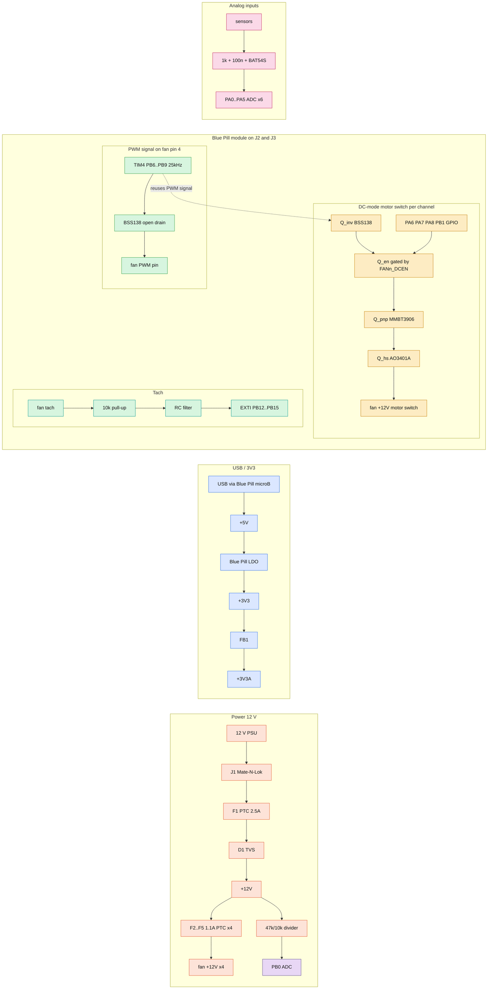

# Fanny — a versatile USB PWM fan controller


A USB controlled board for four 12 V PC fans and six analog sensor inputs. It
is a carrier board for an STM32F103C8T6 "Blue Pill" module. The module shows
up on the host as a USB CDC serial port (`/dev/ttyACM*` or `COMx`).

```
stm32-fan-controller/
├── firmware/          libopencm3 firmware (C11 built with arm-none-eabi-gcc)
│   ├── Core/          main loop / clocks / SysTick / linker script / board pin map
│   ├── Drivers/       libopencm3 git submodule
│   ├── USB_DEVICE/    USB CDC-ACM device
│   ├── App/           fan / pwm / tach / protocol / thermal (analog) / safety
│   └── tests/         host-side unit tests (`make test`)
├── hardware/
│   ├── kicad/         KiCad 10 project with schematic and symbol lib and board. Source of truth and hand-edited
│   ├── bom.csv        bill of materials
│   ├── pcb_3d.png     3D render of the placed board
│   ├── pcb_top.png    placement plot seen from the top
│   └── datasheets/    links to the key datasheets
└── host/              fanctl.py command-line client (pyserial)
```

## Prerequisites

1. KiCad 10.0.7 (`kicad-cli`)

   ```sh
   # Arch
   sudo pacman -S kicad

   # Ubuntu 24.04
   sudo add-apt-repository ppa:kicad/kicad-10.0-releases
   sudo apt update
   sudo apt install kicad
   ```

2. arm-none-eabi-gcc and OpenOCD

   ```sh
   # Arch
   sudo pacman -S arm-none-eabi-gcc arm-none-eabi-newlib openocd

   # Ubuntu 24.04
   sudo apt install gcc-arm-none-eabi openocd
   ```

3. Python 3 and pyserial

   ```sh
   # Arch
   sudo pacman -S python python-pyserial

   # Ubuntu 24.04
   sudo apt install python3 python3-serial
   ```

4. rsvg-convert

   ```sh
   # Arch
   sudo pacman -S librsvg

   # Ubuntu 24.04
   sudo apt install librsvg2-bin
   ```

This tree follows the suggested layout with two changes:

- **libopencm3 instead of the STM32Cube HAL.** The suggested `Core/` and
  `Drivers/` and `USB_DEVICE/` folders are STM32CubeMX output. CubeMX is not
  available here so the firmware uses libopencm3 instead. Its CDC stack is
  small and the build is a plain Makefile. The folder roles stay the same.
- **`hardware/kicad/` instead of separate `schematic/` and `pcb/` folders.**
  KiCad keeps the `.kicad_pro` and `.kicad_sch` and `.kicad_pcb` files of one
  project together in a single directory.

## Hardware design

### Block overview



### Pin map

| Function | Pins | Peripheral |
|---|---|---|
| Fan 1–4 PWM signal and the motor-switch chop signal in DC mode | PB6 PB7 PB8 PB9 | TIM4 CH1–4 at 25 kHz |
| Fan 1–4 DC-mode enable | PA6 PA7 PA8 PB1 | plain push-pull GPIO |
| Fan 1–4 tach | PB12–PB15 | EXTI12–15 on the falling edge |
| AIN1–AIN6 | PA0–PA5 | ADC1 IN0–IN5 |
| 12 V sense | PB0 | ADC1 IN8 |
| USB | PA11 for D− and PA12 for D+ | USB FS |
| SWD | PA13 and PA14 | Blue Pill 4-pin SWD header |
| Status LED | PC13 | Blue Pill on-board LED and active low |
| Clock | PD0/PD1 | Blue Pill 8 MHz crystal with PLL to 72 MHz |

The DC-mode enable pins are plain GPIO rather than a timer remap. Nothing
writes `AFIO_MAPR` so JTAG and SWD both stay exactly as the Blue Pill module
provides them.

### Blue Pill module

The module plugs into two 1×20 female headers (J2 and J3) with rows 15.24 mm
apart. Pin 1 of each row sits at the USB end of the module. Hold the board
with the USB end up and the components facing you. J2 is then the right row
and J3 the left row:

| Pin | J2 on the right | J3 on the left |
|---|---|---|
| 1–4 | GND GND 3V3 NRST | PB12 PB13 PB14 PB15 |
| 5–10 | PB11 PB10 PB1 PB0 PA7 PA6 | PA8 PA9 PA10 PA11 PA12 PA15 |
| 11–16 | PA5 PA4 PA3 PA2 PA1 PA0 | PB3 PB4 PB5 PB6 PB7 PB8 |
| 17–20 | PC15 PC14 PC13 VBAT | PB9 5V GND 3V3 |

The pinout follows the
[DeepBlueMbedded Blue Pill diagram](https://deepbluembedded.com/stm32-blue-pill-pinout-programming-guide/).
Check it against your own module before laying out a board.

The module brings the MCU and the 8 MHz crystal and the 3.3 V regulator and
the PC13 LED and the reset button and the BOOT jumpers and the SWD header and
the micro-B USB connector. It runs from USB alone through its own micro-B
connector. The carrier has no USB connector or wiring of its own. The 12 V
input powers only the fans. The 3V3 pin of the module powers the 3.3 V logic
and the sensor bias on the carrier.

Things worth checking on the module:

- **D+ pull-up (R10):** USB needs 1.5 kΩ but many Blue Pills ship with 10 kΩ.
  Some hosts then fail to enumerate. Swap R10 for 1.5 kΩ if that happens.
- **MCU:** some modules carry a clone such as CS32F103 or CKS32F103 or
  GD32F103 rather than a genuine ST part. The firmware targets the ST part.
  Clones can differ in USB and flash timing.
- **NRST:** the SWD header of the module has no reset pin. Use TP4 or the R
  pin for connect-under-reset.

### Fan channel

Each channel drives a standard 4-pin header where pin 1 is GND and pin 2 is
+12 V and pin 3 is tach and pin 4 is PWM. The same header takes both 4-pin
PWM fans and 3-pin DC fans in either firmware mode. The default mode is `pwm`
and the other is `dc`. See [Protocol](#protocol).

**Supply and motor switch.** Fan pin 2 reaches +12 V through a 1.1 A PTC
(Bourns MF-MSMF110/16) and then through a high-side P-channel MOSFET (`Q_hs`
which is an AO3401A). A shorted fan or cable trips only its own PTC so the
other fans keep running and F1 stays intact. In `pwm` mode the switch is held
fully on and only pin 4 controls speed. That is exactly how a 4-pin-only
board behaves. In `dc` mode the switch chops the +12 V supply at the same
25 kHz duty that pin 4 carries. That is how a 3-pin fan gets speed control at
all since it has no PWM input and leaves pin 4 unconnected.

**Motor switch gate drive.** The MCU cannot drive the P-FET gate directly so
a two-stage inverting chain does the job. A BSS138 (`Q_inv`) is gated by the
same pin-4 PWM signal. That signal is reused rather than given its own net. It
switches an MMBT3906 PNP (`Q_pnp`) which pulls the P-FET gate toward +12 V to
turn the switch off. A second BSS138 (`Q_en`) sits in series between `Q_inv`
and GND and is gated by its own per-channel GPIO that the `mode` command sets.
Both transistors must be on for the chop to reach `Q_pnp`. So `pwm` mode
simply holds `Q_en` off and the pin-4 signal never reaches the gate chain no
matter what its duty is. A 2.2 kΩ resistor (`R_gpd`) holds the P-FET gate at
GND which means the switch is **on** whenever neither stage is driven. A
10 kΩ resistor (`R_dcen`) holds the gate of `Q_en` low by default. This rest
state rather than an actively driven "off" is what satisfies C1 below in
either mode. An SS34 freewheel diode (`D_fw`) across the output of each
channel absorbs the inductive kick of the motor when the switch opens.

**Speed.** In `pwm` mode the firmware sets speed with a 25 kHz signal on pin
4. Many 4-pin fans keep turning at 0 % PWM at their minimum speed and the
board cannot stop such a fan. In `dc` mode speed comes from the motor switch
following that same signal instead. See [Known limits](#known-limits) for the
two caveats that come with it.

**PWM signal transistor.** A BSS138 works as an open-drain driver on fan pin
4. The fan pulls this pin up internally to 5.25 V or less as the Intel 4-wire
spec requires so the MCU pin never sees the voltage of the fan. The transistor
inverts the signal and the firmware compensates with timer mode PWM2.

**Safe state.** A 100 kΩ pull-down holds the PWM transistor off unless the
MCU drives it. That releases pin 4 and a released line reads as 100 %.
`R_gpd` holds the motor switch on and `R_dcen` holds `Q_en` off by the same
logic described above. All three rest states agree with each other. A fan
runs at 100 % with no firmware running in either mode. See
[Failsafe behaviour](#failsafe-behaviour).

**Tach input.** The open-collector output of the fan gets a 10 kΩ pull-up to
3.3 V and then 1 kΩ plus 1 nF of filtering. PB12–PB15 are 5 V tolerant. The
motor switch is high-side so fan GND stays at board GND even while the switch
is open and the tach chain never sees overvoltage in `dc` mode. A fan that
pulls its tach output to 12 V internally sits outside the spec and would need
an extra clamp.

### Compatibility

Verified against the [Intel 4-wire PWM fan spec rev 1.2](https://www.konilabs.net/docs/standards/fan/intel_4wire_pwm_fans_specs_rev1_2.pdf):

| Spec requirement | Board implementation | Status |
|---|---|---|
| Pinout of GND then +12 V then tach then PWM | `Fan_4pin` header wired in that order | Match |
| PWM must be open-drain or open-collector with the fan pulling up | BSS138 open-drain transistor where the MCU only sinks | Match |
| PWM frequency between 21 kHz and 28 kHz with 25 kHz nominal | TIM4 at 72 MHz / 2880 which is exactly 25.000 kHz | Match |
| A released PWM line must run the fan at full speed | 100 kΩ pull-down holds the transistor off until firmware drives it | Match |
| Tach must be open-collector and pulled up at 2 pulses per rev | 10 kΩ pull-up to 3.3 V with `TACH_PULSES_PER_REV = 2` in firmware | Match |
| Tach pull-up rail of 5 V or less into a tolerant input | Pulled to 3.3 V and PB12–PB15 are 5 V tolerant | Match |

See [Fan channel](#fan-channel) above for the per-pin circuit detail.

### Analog inputs (AIN1–AIN6)

Each input is a 3-pin header carrying 3V3A and SIG and GND. The conditioning
chain works like this:

- A 10 kΩ pull-up to 3V3A. Together with a 10 kΩ NTC to GND it forms a
  ratiometric temperature divider. Leave it unfitted for voltage-output
  sensors.
- A 1 kΩ series resistor and 100 nF to GND for anti-aliasing and sample
  charge.
- A BAT54S clamp to GND and 3V3A. PA0–PA5 are **not** 5 V tolerant.

The ADC references VDDA. The firmware measures VREFINT so it can report
millivolts corrected for the actual supply voltage.

### Power

- **12 V input:** a screw terminal followed by a PTC that holds 2.5 A and
  then an SMBJ13A TVS. Reversed polarity makes the TVS conduct and that trips
  the PTC.
- **Module supply:** USB only. The board carries no 5 V or 3.3 V regulator.
  The LDO on the Blue Pill makes 3.3 V from USB VBUS.
- **12 V monitoring:** a 47 kΩ/10 kΩ divider into PB0. Full scale lands near
  18.8 V.
- **USB:** the micro-B connector of the Blue Pill and nothing else. The
  carrier has no USB connector or header or ESD protection of its own. The
  firmware pulls D+ low for 10 ms at boot to force the host to re-enumerate.

### Known limits

- **Current:** each fan header is rated 1 A and each channel has its own
  1.1 A PTC. F1 caps the whole board at 2.5 A so four fans pulling 1 A cannot
  run together. At power-up every fan starts at 100 % at once. Measure the
  combined inrush with the real fans.
- **0 % does not stop every 4-pin fan in `pwm` mode.** See Fan channel. In
  `dc` mode 0 % does stop the fan because the motor switch cuts the supply.
- **3-pin fans in `dc` mode do not start below roughly 30 % to 40 % duty.**
  That is a motor startup limit rather than a firmware clamp. Set a curve
  minimum above it in `fancontrold` and see `fancontrol.conf.example`.
- **Tach under-reads in `dc` mode.** The electronics of the fan are unpowered
  during the chopped-off phase so tach pulses go missing roughly in proportion
  to duty. `stall` is therefore meaningful only near 100 % duty on a `dc`
  channel.
- **25 kHz supply chopping stresses the input capacitor of a fan.** It stays
  inaudible. The chop reuses the pin-4 signal timer (`SIGNAL_PERIOD` in
  `App/pwm.c`) which all four channels share. There is no per-channel
  frequency to lower for one misbehaving fan without also moving the signal
  frequency on every `pwm` channel.

## KiCad project

The KiCad files are the source of truth. Edit them directly in the KiCad GUI.

- `hardware/kicad/fan_controller.kicad_sch`: one A1 sheet grouped by block
  into Power and MCU and Fan 1–4 and Analog inputs and Test points. Each pin
  connects through a net label in netlist style.
- `hardware/kicad/fanctl.kicad_sym`: the project symbol library. Pin numbers
  match the footprint pads.
- `hardware/kicad/fan_controller.kicad_pcb`: an 81 × 78 mm outline with four
  M3 holes and a `Power` net class of 1 mm tracks for the 12 V and GND nets.
- `hardware/bom.csv`.

The 3D model lives under `hardware/kicad/3dmodels/` as `fan_controller.step`
and `fan_controller.glb` and both are committed. The Blue Pill module has no
3D model so only its two sockets show up.

Every footprint on the board points at its model as
`${KIPRJMOD}/3dmodels/<library>.3dshapes/<name>.step`. KiCad resolves
`${KIPRJMOD}` to the project folder so the 3D viewer and the STEP export work
without the KiCad 3D library installed. A footprint added later in the KiCad
GUI keeps its own library path of `${KICAD10_3DMODEL_DIR}/…` instead. To use
a local copy put the `.step` file under `3dmodels/` and change the path on the
3D Models tab of that footprint.

Every footprint comes from the standard KiCad 10 libraries.

The workflow is to open `fan_controller.kicad_pro` and change the schematic or
the board and run ERC and DRC and then route. Re-export the BOM
(`hardware/bom.csv`) and the renders below after any change that affects them.

To refresh `hardware/pcb_3d.png`:

```sh
cd hardware/kicad
kicad-cli pcb render --side top --rotate '-20,0,350' --zoom 0.75 --perspective --floor \
    --background transparent --quality high -w 480 -h 500 -o ../pcb_3d.png fan_controller.kicad_pcb
```

To refresh `hardware/pcb_top.png`:

```sh
kicad-cli pcb export svg --layers Edge.Cuts,F.Cu,F.SilkS,F.Fab --exclude-drawing-sheet \
    --page-size-mode 2 -o top.svg hardware/kicad/fan_controller.kicad_pcb
rsvg-convert -w 1400 -b white top.svg -o hardware/pcb_top.png && rm top.svg
```

Checked with KiCad 10.0.7:

- `kicad-cli sch erc --severity-all` reports 11 errors and 5 warnings. All of
  them predate the `dc`-mode feature. They are unused pins on `J1` and `D1`
  and `C1-C5` and `R2` in the VIN and analog decoupling group that have no
  `no_connect` flags yet plus one spare BluePill pin plus one unresolved
  input-power-pin-not-driven quirk on a GND symbol. All of it is tracked in
  `AGENTS.md`.
- `kicad-cli pcb drc --severity-all` reports 0 errors and 21 warnings. They
  cover silkscreen clearance and overlap in the densest rows plus a few
  dangling-track notices. All cosmetic and none of it blocks fabrication.
- Every footprint loads from the standard libraries and matches its library
  copy.
- Every symbol pin number matches a pad in its footprint and every pad has a
  pin.

### BOM summary plus the Blue Pill module

`hardware/bom.csv` is regenerated from the schematic with `sch export bom`
grouped by value and footprint. The MPN and notes columns are merged back in
by hand. This table reflects the board as built including the per-channel
`dc`-mode motor switch built from `Q_inv` and `Q_en` and `Q_hs` and `Q_pnp`.
See `hardware/3pin_dc_mode_plan.md`.

| Qty | Part | Package | Use | DigiKey |
|---|---|---|---|---|
| 1 | STM32F103C8T6 Blue Pill | module | MCU that plugs into J2 and J3 | not stocked at DigiKey. Buy from module sellers |
| 12 | BSS138 | SOT-23 | PWM signal transistors Q1-4 plus the `Q_inv` and `Q_en` cascade motor-switch gate on 4 channels as Q7 Q10 Q13 Q16 and Q17-20 | [BSS138](https://www.digikey.com/en/products/result?keywords=BSS138) |
| 4 | AO3401A | SOT-23 | `Q_hs` high-side P-MOSFET motor switch | [AO3401A](https://www.digikey.com/en/products/result?keywords=AO3401A) |
| 4 | MMBT3906 | SOT-23 | `Q_pnp` PNP level-shift driver for the `Q_hs` gate | [MMBT3906](https://www.digikey.com/en/products/result?keywords=MMBT3906) |
| 4 | SS34 | SMA | flyback diode across the fan motor in `dc` mode | [SS34](https://www.digikey.com/en/products/result?keywords=SS34) |
| 4 | 0 Ω jumper and DNP | 1206 | `JP1-4` optional full-bypass override. See `3pin_dc_mode_plan.md` | generic 1206 0 Ω bridge or jumper |
| 6 | BAT54S | SOT-23 | analog input clamps | [BAT54S 215](https://www.digikey.com/en/products/result?keywords=BAT54S%2C215) |
| 1 | SMBJ13A | SMB | 12 V TVS | [SMBJ13A](https://www.digikey.com/en/products/result?keywords=SMBJ13A) |
| 1 | MF-MSMF250/16X-2 | 1812 | 2.5 A PTC fuse | [MF-MSMF250/16X-2](https://www.digikey.com/en/products/result?keywords=MF-MSMF250%2F16X-2) |
| 4 | MF-MSMF110/16-2 | 1812 | 1.1 A per-channel PTC fuses | [MF-MSMF110/16-2](https://www.digikey.com/en/products/result?keywords=MF-MSMF110%2F16-2) |
| 4 | Molex 47053-1000 | 4-pin | fan headers | [0470531000](https://www.digikey.com/en/products/result?keywords=0470531000) |
| 2 | 1×20 female header | 2.54 mm | Blue Pill socket | [PPTC201LFBN-RC](https://www.digikey.com/en/products/result?keywords=PPTC201LFBN-RC) from Sullins or any 1×20 socket |
| 1 | TE Connectivity 350424-1 | 4-pin at 5.08 mm | 12 V input on Mate-N-Lok | [350424-1](https://www.digikey.com/en/products/result?keywords=350424-1) |
| 6 | 1×3 headers | 2.54 mm | sensor inputs | any 2.54 mm pin header |
| 6 | test pads | 1.5 mm | +12V and +3V3 and GND and NRST and FAN1_PWM and FAN1_TACH | PCB pads rather than a part |
| — | resistors and capacitors and ferrite | 0603 / 1206 / 6.3 mm | passives | [BLM18AG601SN1D](https://www.digikey.com/en/products/result?keywords=BLM18AG601SN1D) for FB1. Others are generic so see `bom.csv` |

The MPNs in the BOM are examples. Check stock and second sources before
ordering. The DigiKey links are keyword searches by MPN so they keep working
when DigiKey part numbers change. Pick the exact package and reel option from
the results.

## Firmware

### Build

```sh
git clone --recurse-submodules git@github.com:rmskkn/fanny.git
cd fanny
make                 # firmware/build/fanctl.elf, .bin (~11.5 KiB flash)
make flash           # OpenOCD + ST-Link over SWD
make test            # host-side protocol and conversion tests
```

The first `make` builds libopencm3 for STM32F1 only. It also runs
`git submodule update --init` when the clone has no submodule checkout. The
same targets work from inside `firmware/`.

### Architecture

The firmware has no RTOS. It runs a single cooperative main loop fed by two
interrupts. SysTick counts milliseconds and EXTI catches tach edges. ADC
results arrive by DMA.

| Module | Responsibility |
|---|---|
| `Core/main.c` | 72 MHz clock and SysTick and init order and the main loop and the status LED on Blue Pill PC13 |
| `App/pwm.c` | TIM4 fan PWM signal at 25 kHz which doubles as the motor-switch chop signal plus the per-channel DC-mode-enable GPIOs. Starts the timer at 100 % and the enables low before taking the pins |
| `App/fan.c` | Per-channel mode and duty mapped onto the signal PWM and the DC-mode enable |
| `App/tach.c` | Tach pulse count per 1 s window converted to RPM at 2 pulses per rev |
| `App/thermal.c` | ADC1 continuous scan with DMA over AIN1–6 and 12 V and MCU temperature and VREFINT. 1 ms IIR filter and mV conversion |
| `App/safety.c` | IWDG at 1 s plus host-loss failsafe and stall detection |
| `App/protocol.c` | Line-based command parser kept hardware independent so it can be unit tested |
| `USB_DEVICE/usb_cdc.c` | CDC-ACM descriptors and an RX ring buffer and TX with timeout. Output is dropped while the port is closed |

### Failsafe behaviour

All fans run at 100 % whenever the controller is not in control and that holds
in both `pwm` and `dc` mode. Fan power comes straight from 12 V so this needs
nothing but 12 V present. The PWM signal line and the motor switch and the
DC-mode enable all rest in their "fan on" state. Pin 4 is released and
`R_gpd` holds the motor switch on and `R_dcen` holds the enable off. Either
mode reaches 100 % the same way.

| Case | Result |
|---|---|
| Power-up before the first command from the host | 100 % |
| USB unplugged or host powered off | Module unpowered and both switches rest on at 100 % |
| Module pulled out of its socket | Both switches rest on at 100 % |
| Supply sags below the reset threshold of the STM32 near 1.9 V | MCU held in reset and both switches rest on at 100 % |
| Firmware hangs | Watchdog resets the MCU after 1 s and both switches rest on during reset at 100 % |
| No valid command for 10 s while the module is still powered | Firmware failsafe sets 100 % and the LED blinks fast and the mode stays unchanged |

Running `fanctl.py watch` or a control daemon keeps the 10 s timer from
expiring. A fan is flagged `stall=1` when its duty sits above 0 but its tach
reads 0 RPM for 3 s. Fans without a tach wire always show this flag.

### Protocol

The protocol is text over USB CDC and the baud rate is ignored. Each command
is one line ending in `\n` and each reply ends with `ok` or `err <reason>`.

```
> set 2 40          duty 0..100 for fan 1..4 or "all"
ok
> mode 3 dc         pwm (4-pin) | dc (3-pin)
ok
> get
fan 1 mode=pwm duty=100 rpm=1590 stall=0
fan 2 mode=pwm duty=40 rpm=780 stall=0
fan 3 mode=dc duty=100 rpm=1200 stall=0
fan 4 mode=pwm duty=100 rpm=0 stall=1
ain 1 raw=2047 mv=1649
...
v12 mv=12043
vdda mv=3302
mcu temp=31.4
failsafe=0
ok
> ping              keepalive
ok
```

## Host tool

```sh
pip install -r host/requirements.txt
python3 host/fanctl.py -p /dev/ttyACM0 get
python3 host/fanctl.py set all 50
python3 host/fanctl.py mode 3 dc
python3 host/fanctl.py watch -i 2
```

### Setting one fan

Use the fan number from 1 to 4 in place of `all`. Fan 1 is header J5 and fan
4 is header J8.

```sh
python3 host/fanctl.py set 1 50      # fan 1 to 50 %
python3 host/fanctl.py set 3 80      # fan 3 to 80 %
python3 host/fanctl.py set 4 0       # fan 4 to 0 % (some fans keep turning slowly)
python3 host/fanctl.py -p /dev/ttyACM1 set 2 40   # board on another port
```

- Each command sets one fan or all fans. Lists such as `1,2` and ranges such
  as `1-3` are not accepted.
- To check a fan run `python3 host/fanctl.py get` and read the
  `fan N mode=… duty=… rpm=…` line.
- Settings hold only while the host keeps talking to the board. When no
  command arrives for 10 s all fans return to 100 %. Keep `fanctl.py watch`
  or a control daemon running to hold the values.
- `mode <1-4|all> pwm|dc` picks the speed-control path for a channel as
  described in [Fan channel](#fan-channel). It falls back to `pwm` at every
  boot and after every reconnect so the channel of a 3-pin fan needs
  `mode N dc` sent again each time.

The `FanController` class in `fanctl.py` can be imported to build a control
daemon. One example is a daemon that maps an NTC reading from `ain` onto a fan
duty. For a 10 kΩ NTC sitting on the 10 kΩ bias resistor the resistance is
R<sub>NTC</sub> = 10 kΩ × mV / (VDDA − mV).

### Fan control daemon

`host/fancontrold.py` is exactly that daemon. It reads an INI config shown in
`host/fancontrol.conf.example`. The config can set each of the four channels
to a constant duty or to a temperature curve driven by one AIN input or to a
curve driven by the temperature of an NVIDIA GPU through `sensor = gpuN` read
via `nvidia-smi` using the higher of the core and memory temperature. A
managed channel also takes `type = pwm` for the 4-pin default or `type = dc`
for a 3-pin fan. The daemon sends `mode` once at startup and again after every
reconnect because a firmware reset returns every channel to `pwm`. Every cycle
it re-sends the duty of each managed channel which doubles as the ping that
holds off the 10 s firmware failsafe. A channel with no `[fanN]` section is
left alone. `nvidia-smi` must be on `PATH` and no extra Python dependency is
needed.

For a `gpuN` sensor install the proprietary NVIDIA driver which provides
`nvidia-smi`:

```sh
# Arch
sudo pacman -S nvidia nvidia-utils

# Ubuntu 24.04
sudo apt install nvidia-driver-550
```

Reboot the machine to load the nvidia modules. Verify with
`nvidia-smi --query-gpu=index,temperature.gpu,temperature.memory --format=csv`.

```sh
cp host/fancontrol.conf.example ~/.config/fancontrol.conf
# edit ~/.config/fancontrol.conf for your sensors and curves
python3 host/fancontrold.py                 # foreground, Ctrl-C to stop
```

To run it as a systemd user service:

```sh
mkdir -p ~/.config/systemd/user
cp host/systemd/fancontrold.service ~/.config/systemd/user/
# edit ExecStart in that file to this repo's checkout path
systemctl --user daemon-reload
systemctl --user enable --now fancontrold.service
loginctl enable-linger "$USER"   # only if the board must run with no user session logged in
```

## License

Copyright © 2026 Roman Skakun.

This project covers the hardware design files and the firmware and the host
tool. All of it is licensed under
[Creative Commons Attribution-NonCommercial-ShareAlike 4.0 International](LICENSE)
which is CC BY-NC-SA 4.0.

You may build and modify and share this design for personal and other
non-commercial purposes with attribution and under the same license.
Commercial use is not permitted without a separate written license from the
copyright holder. That includes selling assembled boards or bare PCBs or kits.

`firmware/Drivers/libopencm3` is a submodule under its own LGPL-3.0 license
and is not covered by the above.
