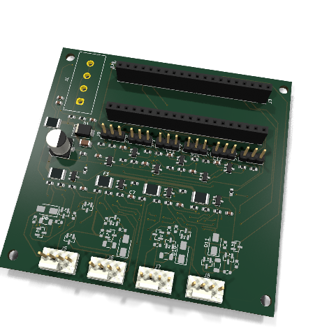

# Fanny — a versatile USB PWM fan controller



USB-controlled controller for four 12 V PC fans and six analog sensor inputs.
It is a carrier board for an STM32F103C8T6 "Blue Pill" module, which shows up
on the host as a USB CDC serial port (`/dev/ttyACM*`, `COMx`).

```
stm32-fan-controller/
├── firmware/          libopencm3 firmware (C11, arm-none-eabi-gcc)
│   ├── Core/          main loop, clocks, SysTick, linker script, board pin map
│   ├── Drivers/       libopencm3 git submodule
│   ├── USB_DEVICE/    USB CDC-ACM device
│   ├── App/           fan, pwm, tach, protocol, thermal (analog), safety
│   └── tests/         host-side unit tests (`make test`)
├── hardware/
│   ├── kicad/         KiCad 10 project (schematic, symbol lib, board outline) — source of truth, hand-edited
│   ├── bom.csv        bill of materials
│   ├── pcb_3d.png     3D render of the placed board
│   ├── pcb_top.png    placement plot, top view
│   └── datasheets/    links to the key datasheets
└── host/              fanctl.py command-line client (pyserial)
```

This tree follows the suggested layout with two changes:

- **libopencm3 instead of the STM32Cube HAL.** The suggested `Core/`,
  `Drivers/` and `USB_DEVICE/` folders are STM32CubeMX output. CubeMX is not
  available here, so the firmware uses libopencm3. Its CDC stack is small and
  the build is a plain Makefile. The folder roles are the same.
- **`hardware/kicad/` instead of separate `schematic/` and `pcb/` folders.**
  KiCad keeps a project's `.kicad_pro`, `.kicad_sch` and `.kicad_pcb` files in
  one directory.

## Hardware design

### Block overview

```
 12 V (PSU) ─ J1 Mate-N-Lok ─ F1 PTC ─ D1 TVS ── +12V ─┬─ F2..F5 1.1 A PTC ─► fan +12V (×4)
                                                        └─ 47k/10k ─► PB0
 USB (Blue Pill micro-B only) ── +5V ── Blue Pill LDO ── +3V3 ─ FB1 ─ +3V3A
            ┌──────────── Blue Pill module (J2, J3) ─────────┐
            │                       TIM4 PB6..PB9 (25 kHz) ─► BSS138 open drain ─► fan PWM pin
            │                       EXTI PB12..PB15 ◄─ RC ◄─ 10k pull-up ◄─ fan tach
 sensors ─ 1k + 100n + BAT54S ─► PA0..PA5 (ADC)    PB0 ◄─ 47k/10k ◄─ +12V
```

### Pin map

| Function | Pins | Peripheral |
|---|---|---|
| Fan 1–4 PWM signal | PB6, PB7, PB8, PB9 | TIM4 CH1–4, 25 kHz |
| Fan 1–4 tach | PB12–PB15 | EXTI12–15, falling edge |
| AIN1–AIN6 | PA0–PA5 | ADC1 IN0–IN5 |
| 12 V sense | PB0 | ADC1 IN8 |
| USB | PA11 (D−), PA12 (D+) | USB FS |
| SWD | PA13, PA14 | Blue Pill 4-pin SWD header |
| Status LED | PC13 | Blue Pill on-board LED, active low |
| Clock | PD0/PD1 | Blue Pill 8 MHz crystal, PLL to 72 MHz |

### Blue Pill module

The module plugs into two 1×20 female headers (J2, J3) with rows 15.24 mm
apart. Pin 1 of each row is at the module's USB end. With the USB end up and
the components facing you, J2 is the right row and J3 the left row:

| Pin | J2 (row A, right) | J3 (row B, left) |
|---|---|---|
| 1–4 | GND, GND, 3V3, NRST | PB12, PB13, PB14, PB15 |
| 5–10 | PB11, PB10, PB1, PB0, PA7, PA6 | PA8, PA9, PA10, PA11, PA12, PA15 |
| 11–16 | PA5, PA4, PA3, PA2, PA1, PA0 | PB3, PB4, PB5, PB6, PB7, PB8 |
| 17–20 | PC15, PC14, PC13, VBAT | PB9, 5V, GND, 3V3 |

The pinout follows the
[DeepBlueMbedded Blue Pill diagram](https://deepbluembedded.com/stm32-blue-pill-pinout-programming-guide/).
Check it against your module before laying out the board.

The module provides the MCU, the 8 MHz crystal, the 3.3 V regulator, the PC13
LED, the reset button, the BOOT jumpers, the SWD header and the micro-B USB
connector. The module runs from USB only, through its own micro-B connector —
the carrier has no USB connector or wiring of its own. The 12 V input powers
only the fans. The module's 3V3 pin powers the carrier's 3.3 V logic and
sensor bias.

Things to check on the module:

- **D+ pull-up (R10):** USB needs 1.5 kΩ, but many Blue Pills fit 10 kΩ, and
  some hosts then fail to enumerate. Replace R10 with 1.5 kΩ if needed.
- **MCU:** some modules carry a clone such as CS32F103, CKS32F103 or
  GD32F103 instead of an ST part. The firmware targets the ST part. Clones can
  differ in USB and flash timing.
- **NRST:** the module's SWD header has no reset pin. Use TP4 or the R pin
  for connect-under-reset.

### Fan channel

Each channel drives a standard 4-pin header (1 GND, 2 +12 V, 3 tach, 4 PWM)
and supports 4-pin PWM fans only.

**Supply.** Fan pin 2 connects to +12 V through a 1.1 A PTC (Bourns
MF-MSMF110/16). There is no supply switch, so a fan always has power while
12 V is present. A shorted fan or cable trips only its own PTC, so the other
fans keep running and F1 does not trip.

**Speed.** The firmware sets speed with a 25 kHz signal on pin 4. Many 4-pin
fans keep turning at 0 % PWM, at their minimum speed. The board cannot stop
such a fan.

**PWM signal buffer.** A BSS138 works as an open-drain driver on fan pin 4.
The fan pulls this pin up internally to ≤5.25 V (Intel 4-wire spec), so the
MCU pin never sees the fan's voltage. The buffer inverts the signal, and the
firmware compensates with timer mode PWM2.

**Safe state.** A 100 kΩ pull-down holds each BSS138 off unless the MCU
drives it. The PWM line is then released, and a fan runs at 100 % on a
released line. See [Failsafe behaviour](#failsafe-behaviour).

**Tach input.** The fan's open-collector output has a 10 kΩ pull-up to 3.3 V,
then 1 kΩ + 1 nF filtering. PB12–PB15 are 5 V tolerant. A fan that pulls its
tach output to 12 V internally (outside the spec) would need an extra clamp.

### Compatibility

Verified against the [Intel 4-wire PWM fan spec rev 1.2](https://www.konilabs.net/docs/standards/fan/intel_4wire_pwm_fans_specs_rev1_2.pdf):

| Spec requirement | Board implementation | Status |
|---|---|---|
| Pinout: 1 GND, 2 +12 V, 3 tach, 4 PWM | `Fan_4pin` header wired in that order | Match |
| PWM: open-drain/collector, fan pulls up internally | BSS138 open-drain buffer, MCU only sinks | Match |
| PWM frequency: 21–28 kHz target (25 kHz nominal) | TIM4 at 72 MHz / 2880 = 25.000 kHz exact | Match |
| PWM line released = fan runs full speed (fail-safe) | 100 kΩ pull-down holds buffer off until firmware drives it | Match |
| Tach: open-collector, pulled up, 2 pulses/rev | 10 kΩ pull-up to 3.3 V, `TACH_PULSES_PER_REV = 2` in firmware | Match |
| Tach pull-up rail ≤ 5 V tolerant input | Pulled to 3.3 V; PB12–PB15 are 5 V tolerant | Match |

See [Fan channel](#fan-channel) above for the per-pin circuit detail.

### Analog inputs (AIN1–AIN6)

Each input is a 3-pin header: 3V3A, SIG, GND. The conditioning chain is:

- A 10 kΩ pull-up to 3V3A. With a 10 kΩ NTC to GND it forms a ratiometric
  temperature divider. Leave it unfitted for voltage-output sensors.
- 1 kΩ series resistor and 100 nF to GND, for anti-aliasing and sample charge.
- A BAT54S clamp to GND and 3V3A. PA0–PA5 are **not** 5 V tolerant.

The ADC references VDDA. The firmware measures VREFINT to report millivolts
that are corrected for the actual supply voltage.

### Power

- **12 V input:** screw terminal, then PTC (2.5 A hold), then SMBJ13A TVS.
  With reversed polarity, the TVS conducts and trips the PTC.
- **Module supply:** USB only. The board has no 5 V or 3.3 V regulator. The
  Blue Pill's own LDO makes 3.3 V from USB VBUS.
- **12 V monitoring:** 47 kΩ/10 kΩ divider to PB0. Full scale is about 18.8 V.
- **USB:** Blue Pill micro-B connector only; the carrier has no USB
  connector, header or ESD protection of its own. The firmware pulls D+ low
  for 10 ms at boot to force host re-enumeration.

### Known limits

- **Current:** fan headers are rated 1 A each, and each channel has a 1.1 A
  PTC. Total current is limited to 2.5 A by F1, so four fans at 1 A cannot all
  run at once. At power-up all fans start at 100 % together. Measure the
  combined inrush with the real fans.
- **0 % does not stop every fan:** see Fan channel.
- **12 V sense without USB:** with 12 V present and USB unplugged, the
  47 kΩ/10 kΩ divider feeds about 2.1 V into the unpowered PB0 pin. The
  current is about 40 µA, far below the STM32's injection limit.
- **3-pin fans:** not supported. They run at full speed on these headers.
- **USB VID/PID:** the firmware uses ST's VCP IDs (0483:5740). Replace them
  before shipping a product.

## KiCad project

The KiCad files are the source of truth: edit them directly in the KiCad
GUI.

- `hardware/kicad/fan_controller.kicad_sch`: one A1 sheet, grouped by block
  (Power, MCU, Fan 1–4, Analog inputs, Test points). Each pin connects through a net
  label (netlist-style).
- `hardware/kicad/fanctl.kicad_sym`: project symbol library. Pin numbers
  match the footprint pads.
- `hardware/kicad/fan_controller.kicad_pcb`: 75 × 60 mm outline, four M3
  holes, and a `Power` net class (1 mm tracks) for the 12 V and GND nets.
- `hardware/bom.csv`.

The 3D model (`fan_controller.step`, `fan_controller.glb`) lives under
`hardware/kicad/3dmodels/` and is committed. The Blue Pill module has no 3D
model, so only its two sockets appear.

Every footprint on the board points to its model as
`${KIPRJMOD}/3dmodels/<library>.3dshapes/<name>.step`. KiCad resolves
`${KIPRJMOD}` to the project folder, so the 3D viewer and STEP export use
these files without the KiCad 3D library installed. A footprint added later
in the KiCad GUI keeps its library path (`${KICAD10_3DMODEL_DIR}/…`). To use a
local copy, put the `.step` file under `3dmodels/` and change the path in
the footprint's 3D Models tab.

Every footprint is from the standard KiCad 10 libraries.

Workflow: open `fan_controller.kicad_pro`, change the schematic and/or
board, run ERC/DRC, then route. Re-export the BOM (`hardware/bom.csv`) and
the renders below after a change that affects them.

To refresh `hardware/pcb_3d.png`:

```sh
docker run --rm -u $(id -u):$(id -g) -e HOME=/tmp -v "$PWD/hardware":/w -w /w/kicad kicad/kicad:10.0 \
    kicad-cli pcb render --side top --rotate '-20,0,350' --zoom 0.75 --perspective --floor \
    --background transparent --quality high -w 480 -h 500 -o /w/pcb_3d.png fan_controller.kicad_pcb
```

To refresh `hardware/pcb_top.png`:

```sh
docker run --rm -u $(id -u):$(id -g) -e HOME=/tmp -v "$PWD":/w -w /w kicad/kicad:10.0 \
    kicad-cli pcb export svg --layers Edge.Cuts,F.Cu,F.SilkS,F.Fab --exclude-drawing-sheet \
    --page-size-mode 2 -o top.svg hardware/kicad/fan_controller.kicad_pcb
rsvg-convert -w 1400 -b white top.svg -o hardware/pcb_top.png && rm top.svg
```

Checked with KiCad 10.0.7:

- `kicad-cli sch erc --severity-all` reports 0 errors, 3 warnings (pre-existing
  single-pin net-label notices).
- `kicad-cli pcb drc --severity-all` reports 0 errors, 14 warnings (silkscreen
  clearance between adjacent parts in the densest rows; cosmetic, not a fab
  blocker).
- Every footprint loads from the standard libraries and matches its library
  copy.
- Every symbol pin number matches a pad in its footprint, and every pad has a pin.

### BOM summary (plus the Blue Pill module)

`hardware/bom.csv` is stale (see the known gap above — it still lists the old
2-pin terminal-block J1 and the removed USB header/ESD parts). This table
reflects the board as built:

| Qty | Part | Package | Use | DigiKey |
|---|---|---|---|---|
| 1 | STM32F103C8T6 Blue Pill | module | MCU, plugs into J2/J3 | not stocked at DigiKey; buy from module sellers |
| 4 | BSS138 | SOT-23 | PWM buffers | [BSS138](https://www.digikey.com/en/products/result?keywords=BSS138) |
| 6 | BAT54S | SOT-23 | analog input clamps | [BAT54S,215](https://www.digikey.com/en/products/result?keywords=BAT54S%2C215) |
| 1 | SMBJ13A | SMB | 12 V TVS | [SMBJ13A](https://www.digikey.com/en/products/result?keywords=SMBJ13A) |
| 1 | MF-MSMF250/16X-2 | 1812 | 2.5 A PTC fuse | [MF-MSMF250/16X-2](https://www.digikey.com/en/products/result?keywords=MF-MSMF250%2F16X-2) |
| 4 | MF-MSMF110/16-2 | 1812 | 1.1 A per-channel PTC fuses | [MF-MSMF110/16-2](https://www.digikey.com/en/products/result?keywords=MF-MSMF110%2F16-2) |
| 4 | Molex 47053-1000 | 4-pin | fan headers | [0470531000](https://www.digikey.com/en/products/result?keywords=0470531000) |
| 2 | 1×20 female header | 2.54 mm | Blue Pill socket | [PPTC201LFBN-RC](https://www.digikey.com/en/products/result?keywords=PPTC201LFBN-RC) (Sullins, or any 1×20 socket) |
| 1 | TE Connectivity 350424-1 | 4-pin, 5.08 mm | 12 V input, Mate-N-Lok | [350424-1](https://www.digikey.com/en/products/result?keywords=350424-1) |
| 6 | 1×3 headers | 2.54 mm | sensor inputs | any 2.54 mm pin header |
| 6 | test pads | 1.5 mm | +12V, +3V3, GND, NRST, FAN1_PWM, FAN1_TACH | — (PCB pads, not a part) |
| — | resistors, capacitors, ferrite | 0603 / 1206 / 6.3 mm | passives | [BLM18AG601SN1D](https://www.digikey.com/en/products/result?keywords=BLM18AG601SN1D) (FB1); others generic, see `bom.csv` (minus the stale USB-section rows) |

The MPNs in the BOM are examples. Check stock and second sources before ordering.
The DigiKey links are keyword searches by MPN, so they still work when DigiKey
part numbers change. Pick the exact package and reel option from the results.

## Firmware

### Build

```sh
git clone --recurse-submodules git@github.com:rmskkn/fanny.git
cd fanny
make                 # firmware/build/fanctl.elf, .bin (~11.5 KiB flash)
make flash           # OpenOCD + ST-Link over SWD
make test            # host-side protocol and conversion tests
```

The first `make` builds libopencm3 for STM32F1 only. It also runs
`git submodule update --init` if the clone has no submodule checkout.
The same targets work from inside `firmware/`.

### Architecture

The firmware has no RTOS. It runs a single cooperative main loop, and two
interrupts feed it: SysTick for milliseconds and EXTI for tach edges. ADC
results arrive by DMA.

| Module | Responsibility |
|---|---|
| `Core/main.c` | 72 MHz clock, SysTick, init order, main loop, status LED (Blue Pill PC13) |
| `App/pwm.c` | TIM4 fan PWM signal, 25 kHz. Starts the timer at 100 % before taking the pins |
| `App/fan.c` | Per-channel duty, mapped onto the PWM signal |
| `App/tach.c` | Tach pulse count per 1 s window, converted to RPM (2 pulses/rev) |
| `App/thermal.c` | ADC1 continuous scan + DMA: AIN1–6, 12 V, MCU temperature, VREFINT. 1 ms IIR filter, mV conversion |
| `App/safety.c` | IWDG (1 s), host-loss failsafe, stall detection |
| `App/protocol.c` | Line-based command parser, hardware-independent so it can be unit tested |
| `USB_DEVICE/usb_cdc.c` | CDC-ACM descriptors, RX ring buffer, TX with timeout. Output is dropped while the port is closed |

### Failsafe behaviour

All fans run at 100 % whenever the controller is not in control. Fan power
comes straight from 12 V, so this needs only 12 V present.

| Case | Result |
|---|---|
| Power-up, before the host's first command | 100 % |
| USB unplugged or host powered off | Module unpowered, PWM lines released, 100 % |
| Module pulled out of its socket | PWM lines released, 100 % |
| Supply sags below the STM32's reset threshold (about 1.9 V) | MCU held in reset, PWM lines released, 100 % |
| Firmware hangs | Watchdog (1 s) resets the MCU, PWM lines released during reset, 100 % |
| No valid command for 10 s, module still powered | Firmware failsafe sets 100 %, LED blinks fast |

`fanctl.py watch` or a control daemon keeps the 10 s timer from expiring.
A fan is flagged `stall=1` when its duty is above 0 but its tach reads 0 RPM
for 3 s. Fans without a tach wire always show this flag.

### Protocol

The protocol is text over USB CDC. The baud rate is ignored. Each command
is one line ending in `\n`, and each reply ends with `ok` or `err <reason>`.

```
> set 2 40          duty 0..100 for fan 1..4 or "all"
ok
> get
fan 1 duty=100 rpm=1590 stall=0
fan 2 duty=40 rpm=780 stall=0
fan 3 duty=100 rpm=1200 stall=0
fan 4 duty=100 rpm=0 stall=1
ain 1 raw=2047 mv=1649
...
v12 mv=12043
vdda mv=3302
mcu temp=31.4
failsafe=0
ok
> ping              keepalive
ok
```

## Host tool

```sh
pip install -r host/requirements.txt
python3 host/fanctl.py -p /dev/ttyACM0 get
python3 host/fanctl.py set all 50
python3 host/fanctl.py watch -i 2
```

### Setting one fan

Use the fan number (1–4) in place of `all`. Fan 1 is header J5, and fan 4 is header J8.

```sh
python3 host/fanctl.py set 1 50      # fan 1 to 50 %
python3 host/fanctl.py set 3 80      # fan 3 to 80 %
python3 host/fanctl.py set 4 0       # fan 4 to 0 % (some fans keep turning slowly)
python3 host/fanctl.py -p /dev/ttyACM1 set 2 40   # board on another port
```

- Each command sets one fan or all fans. Lists such as `1,2` and ranges such as `1-3` are not accepted.
- To check a fan, run `python3 host/fanctl.py get`. Read the `fan N duty=… rpm=…` line.
- Settings hold only while the host keeps talking to the board. When no
  command arrives for 10 s, all fans return to 100 %. Keep `fanctl.py watch`
  or a control daemon running to hold the values.

The `FanController` class in `fanctl.py` can be imported to build a control
daemon, for example one that maps an NTC reading from `ain` to a fan duty.
For a 10 kΩ NTC on the 10 kΩ bias resistor, the resistance is
R<sub>NTC</sub> = 10 kΩ × mV / (VDDA − mV).

### Fan control daemon

`host/fancontrold.py` is that daemon. It reads an INI config
(`host/fancontrol.conf.example`) that sets each of the four channels to a
constant duty, a temperature curve driven by one AIN input, or a curve
driven by an NVIDIA GPU's temperature (`sensor = gpuN`, read via
`nvidia-smi`, using the max of core and memory temperature). Every cycle it
re-sends each managed channel's duty, which doubles as the ping that holds
off the firmware's 10 s failsafe. A channel with no `[fanN]` section is left
alone. `nvidia-smi` must be on `PATH`; no extra Python dependency is needed.

For a `gpuN` sensor, install the proprietary NVIDIA driver, which provides
`nvidia-smi`:

```sh
# Arch
sudo pacman -S nvidia nvidia-utils

# Ubuntu 24.04
sudo apt install nvidia-driver-550
```

Reboot machine to load nvidia modules.
Verify with `nvidia-smi --query-gpu=index,temperature.gpu,temperature.memory --format=csv`.

```sh
cp host/fancontrol.conf.example ~/.config/fancontrol.conf
# edit ~/.config/fancontrol.conf for your sensors and curves
python3 host/fancontrold.py                 # foreground, Ctrl-C to stop
```

To run it as a systemd user service:

```sh
mkdir -p ~/.config/systemd/user
cp host/systemd/fancontrold.service ~/.config/systemd/user/
# edit ExecStart in that file to this repo's checkout path
systemctl --user daemon-reload
systemctl --user enable --now fancontrold.service
loginctl enable-linger "$USER"   # only if the board must run with no user session logged in
```

## License

Copyright © 2026 Roman Skakun.

This project — hardware design files, firmware, and host tool — is licensed
under [Creative Commons Attribution-NonCommercial-ShareAlike 4.0 International](LICENSE)
(CC BY-NC-SA 4.0).

You may build, modify, and share this design for personal and other
non-commercial purposes, with attribution, and under the same license.
Commercial use — including selling assembled boards, bare PCBs, or kits — is
not permitted without a separate written license from the copyright holder.

`firmware/Drivers/libopencm3` is a submodule under its own license (LGPL-3.0)
and is not covered by the above.

## TODO

1. **3-pin fan motor-side PWM.** Current PWM buffer (BSS138 on pin 4) switches
   only the fan's signal pin, not motor current. A 3-pin fan has no PWM input;
   speed control would need the GND (or +12 V) return routed through a power
   MOSFET sized for motor current, plus a flyback diode across the motor for
   inductive kickback. Neither is present on this board revision — a 3-pin fan
   wired to the existing header always runs at full speed.
