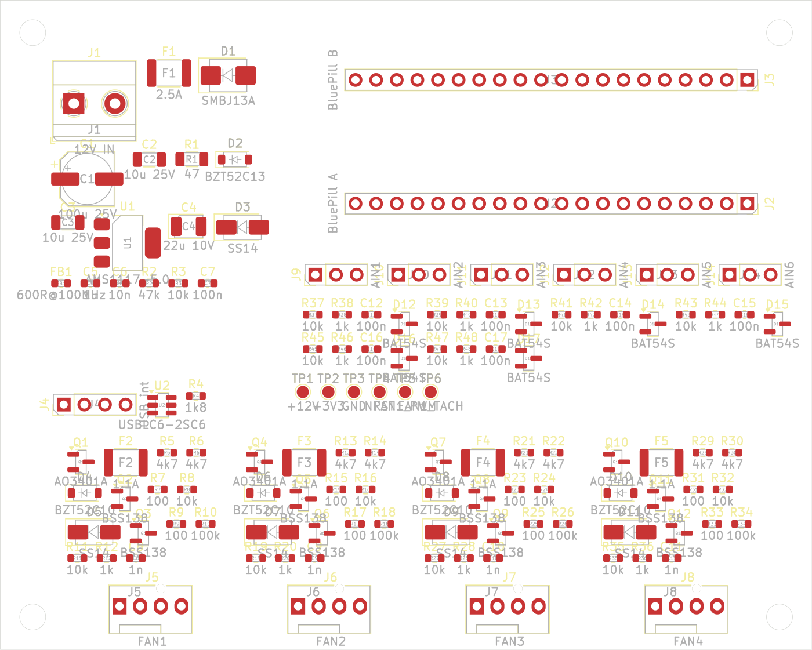

# STM32F103 PWM fan controller



USB-controlled controller for four 12 V PC fans and six analog sensor inputs.
It is a carrier board for an STM32F103C8T6 "Blue Pill" module, which shows up
on the host as a USB CDC serial port (`/dev/ttyACM*`, `COMx`).

```
stm32-fan-controller/
├── firmware/          libopencm3 firmware (C11, arm-none-eabi-gcc)
│   ├── Core/          main loop, clocks, SysTick, linker script, board pin map
│   ├── Drivers/       libopencm3 git submodule
│   ├── USB_DEVICE/    USB CDC-ACM device
│   ├── App/           fan, pwm, tach, protocol, thermal (analog), safety
│   └── tests/         host-side unit tests (`make test`)
├── hardware/
│   ├── kicad/         KiCad 8 project (schematic, symbol lib, board outline)
│   ├── tools/         gen_kicad.py (KiCad files, bom.csv), place_pcb.py (placement, 3D)
│   ├── bom.csv        bill of materials (generated)
│   ├── pcb_top.png    top view of the placed board
│   └── datasheets/    links to the key datasheets
└── host/              fanctl.py command-line client (pyserial)
```

This tree follows the suggested layout with two changes:

- **libopencm3 instead of the STM32Cube HAL.** The suggested `Core/`,
  `Drivers/` and `USB_DEVICE/` folders are STM32CubeMX output. CubeMX is not
  available here, so the firmware uses libopencm3. Its CDC stack is small and
  the build is a plain Makefile. The folder roles are the same.
- **`hardware/kicad/` instead of separate `schematic/` and `pcb/` folders.**
  KiCad keeps a project's `.kicad_pro`, `.kicad_sch` and `.kicad_pcb` files in
  one directory.

## Hardware design

### Block overview

```
 12 V (PSU) ─ F1 PTC ─ D1 TVS ─┬──────────────────── +12V ─────────────────────────┐
                               │                                                   │ ×4
           R1 47R ─ D2 13V ─ U1 AMS1117-5.0 ─ D3 SS14 ─ +5V ─┐                     │
                                                             │  +3V3 (Blue Pill LDO) ─ FB1 ─ +3V3A
            ┌──────────── Blue Pill module (J2, J3) ─────────┐                     │
 USB int ─ U2 ESD ─ PA11/PA12       TIM2 PA15 PB3 PB10 PB11 ─► BSS138 ─► AO3401A high-side ─► PTC ─► fan +12V
            │                       TIM4 PB6..PB9 (25 kHz) ─► BSS138 open drain ─► fan PWM pin
            │                       EXTI PB12..PB15 ◄─ RC ◄─ 10k pull-up ◄─ fan tach
 sensors ─ 1k + 100n + BAT54S ─► PA0..PA5 (ADC)    PB0 ◄─ 47k/10k ◄─ +12V
```

### Pin map

| Function | Pins | Peripheral |
|---|---|---|
| Fan 1–4 supply switch | PA15, PB3, PB10, PB11 | TIM2 CH1–4 (full remap), 30 Hz |
| Fan 1–4 PWM signal | PB6, PB7, PB8, PB9 | TIM4 CH1–4, 25 kHz |
| Fan 1–4 tach | PB12–PB15 | EXTI12–15, falling edge |
| AIN1–AIN6 | PA0–PA5 | ADC1 IN0–IN5 |
| 12 V sense | PB0 | ADC1 IN8 |
| USB | PA11 (D−), PA12 (D+) | USB FS |
| SWD | PA13, PA14 | Blue Pill 4-pin SWD header; JTAG disabled to free PA15/PB3 |
| Status LED | PC13 | Blue Pill on-board LED, active low |
| Clock | PD0/PD1 | Blue Pill 8 MHz crystal, PLL to 72 MHz |

### Blue Pill module

The module plugs into two 1×20 female headers (J2, J3) with rows 15.24 mm
apart. Pin 1 of each row is at the module's USB end. With the USB end up and
the components facing you, J2 is the right row and J3 the left row:

| Pin | J2 (row A, right) | J3 (row B, left) |
|---|---|---|
| 1–4 | GND, GND, 3V3, NRST | PB12, PB13, PB14, PB15 |
| 5–10 | PB11, PB10, PB1, PB0, PA7, PA6 | PA8, PA9, PA10, PA11, PA12, PA15 |
| 11–16 | PA5, PA4, PA3, PA2, PA1, PA0 | PB3, PB4, PB5, PB6, PB7, PB8 |
| 17–20 | PC15, PC14, PC13, VBAT | PB9, 5V, GND, 3V3 |

The pinout follows the
[DeepBlueMbedded Blue Pill diagram](https://deepbluembedded.com/stm32-blue-pill-pinout-programming-guide/).
Check it against your module before laying out the board.

The module provides the MCU, the 8 MHz crystal, the 3.3 V regulator, the PC13
LED, the reset button, the BOOT jumpers, the SWD header and the micro-B USB
connector. The carrier powers the module through its 5V pin, and the module's
3V3 pin powers the carrier's 3.3 V logic and sensor bias.

Things to check on the module:

- **D+ pull-up (R10):** USB needs 1.5 kΩ, but many Blue Pills fit 10 kΩ, and
  some hosts then fail to enumerate. Either replace R10, or fit the carrier's
  R4 (1.8 kΩ, DNP by default). 1.8 kΩ in parallel with 10 kΩ gives 1.5 kΩ.
- **MCU:** some modules carry a clone such as CS32F103, CKS32F103 or
  GD32F103 instead of an ST part. The firmware targets the ST part. Clones can
  differ in USB and flash timing.
- **NRST:** the module's SWD header has no reset pin. Use TP4 or the R pin
  for connect-under-reset.

### Fan channel

Each channel drives a standard 4-pin header (1 GND, 2 +12 V, 3 tach, 4 PWM).
The channel has two control paths, and the firmware selects between them per channel:

- **`pwm` mode (4-pin fans):** the high-side MOSFET stays fully on. Speed is
  set by a 25 kHz signal on pin 4. Duty 0 % also switches the supply off,
  because many 4-pin fans keep turning at 0 % PWM.
- **`dc` mode (3-pin fans):** the MOSFET chops the 12 V supply at 30 Hz, and
  the PWM pin is held high.

**High-side switch, AO3401A (P-channel, −30 V, ±12 V V<sub>GS</sub>, ≤52 mΩ at −4.5 V).**
The source connects to +12 V. The drain feeds fan pin 2 through a per-channel PTC. The 3.3 V MCU cannot
drive the gate directly, so a BSS138 pulls the gate low through a resistor divider.

**Gate protection.** The AO3401A is rated only ±12 V gate-source, which
equals the supply voltage. The design therefore never applies the full rail to the gate:

| Part | Value | Role |
|---|---|---|
| R<sub>GS</sub> (gate to source) | 4.7 kΩ | Keeps the FET off by default and discharges the gate |
| R<sub>G</sub> (gate to BSS138 drain) | 4.7 kΩ | Forms a divider with R<sub>GS</sub>: V<sub>GS</sub> = −12 V × 4.7/9.4 = **−6 V** when on. It also limits zener current |
| D<sub>Z</sub> BZT52C10 (K at source, A at gate) | 10 V | Clamps V<sub>GS</sub> to −10 V when the 12 V rail spikes above ~20 V. Its forward drop clamps positive V<sub>GS</sub> to +0.7 V |
| D1 SMBJ13A | rail TVS | Limits rail surges seen by V<sub>DS</sub> and by the gate network |

At −6 V the FET is well enhanced, so a 1 A fan dissipates about 50 mW. The
divider draws 1.3 mA per channel while the fan is on. Gate switching takes
a few microseconds through 4.7 kΩ, so `dc` mode uses a 30 Hz chopping frequency
to keep switching loss negligible. Raising the frequency needs a stronger gate driver.

**Channel fuse.** A 1.1 A PTC (Bourns MF-MSMF110/16) sits between the FET drain
and fan pin 2. A shorted fan or cable trips only its own channel, so the other
fans keep running and F1 does not trip.

**Freewheel diode** SS14 is fitted across each fan output. It absorbs the
inductive kick from the motor and cable when the switch opens.

**PWM signal buffer.** A BSS138 works as an open-drain driver on fan pin 4.
The fan pulls this pin up internally to ≤5.25 V (Intel 4-wire spec), so the
MCU pin never sees the fan's voltage. The buffer inverts the signal, and the
firmware compensates with timer mode PWM2.

**Safe state while the MCU is in reset or unprogrammed:**
- A 10 kΩ pull-up to 3.3 V on each supply BSS138 gate turns the supply FET on.
- A 100 kΩ pull-down on each PWM BSS138 gate releases the PWM line, so the fan reads 100 %.

With both, all fans run at full speed before the firmware starts.

**Tach input.** The fan's open-collector output has a 10 kΩ pull-up to 3.3 V,
then 1 kΩ + 1 nF filtering. PB12–PB15 are 5 V tolerant. A fan that pulls its
tach output to 12 V internally (outside the spec) would need an extra clamp.

### Analog inputs (AIN1–AIN6)

Each input is a 3-pin header: 3V3A, SIG, GND. The conditioning chain is:

- A 10 kΩ pull-up to 3V3A. With a 10 kΩ NTC to GND it forms a ratiometric
  temperature divider. Leave it unfitted for voltage-output sensors.
- 1 kΩ series resistor and 100 nF to GND, for anti-aliasing and sample charge.
- A BAT54S clamp to GND and 3V3A. PA0–PA5 are **not** 5 V tolerant.

The ADC references VDDA. The firmware measures VREFINT to report millivolts
that are corrected for the actual supply voltage.

### Power

- **12 V input:** screw terminal, then PTC (2.5 A hold), then SMBJ13A TVS.
  With reversed polarity, the TVS conducts and trips the PTC.
- **Module supply:** an AMS1117-5.0 makes 5 V from +12 V. It feeds the Blue
  Pill's 5V pin through an SS14 Schottky. The module ties USB VBUS directly to
  its 5V pin, so the diode keeps a USB host from back-feeding the LDO. With USB
  plugged in, VBUS (5 V) is above the diode output (about 4.65 V) and powers
  the module. The board can be programmed over USB alone, without 12 V.
- **LDO input protection:** the 12 V feed goes through a 47 Ω resistor (1206),
  and a BZT52C13 zener clamps the LDO input. The TVS lets the rail reach
  21.5 V during a surge. The resistor and zener keep the LDO input below its
  15 V limit. The resistor drops about 2.4 V at 50 mA, so the LDO dissipates
  about 0.23 W.
- **LDO output capacitor:** 22 µF tantalum. The AMS1117 needs output ESR for
  stability, and a low-ESR ceramic alone can make it oscillate.
- **12 V monitoring:** 47 kΩ/10 kΩ divider to PB0. Full scale is about 18.8 V.
- **USB:** the Blue Pill's micro-B connector and the carrier's 4-pin header
  (J4) are wired in parallel. Use the header for a cable to an internal
  motherboard USB 2.0 port. Connect only one of them at a time. U2 protects
  the header path against ESD. The firmware pulls D+ low for 10 ms at boot to
  force re-enumeration.

### Known limits

- **Current:** fan headers are rated 1 A each, and each channel has a 1.1 A
  PTC. Total current is limited to 2.5 A by F1, so four fans at 1 A cannot all
  run at once. At power-up all fans start at 100 % together. Measure the
  combined inrush with the real fans.
- **`dc` mode tach:** with the supply chopped, the tach reading is only valid
  at 100 % duty.
- **USB VID/PID:** the firmware uses ST's VCP IDs (0483:5740). Replace them
  before shipping a product.

## KiCad project

`hardware/tools/gen_kicad.py` is the single source of truth for the netlist.
It writes the following:

- `hardware/kicad/fan_controller.kicad_sch`: one A1 sheet, grouped by block
  (Power, MCU, USB, Fan 1–4, Analog inputs, Test points). Each pin connects through a net
  label (netlist-style).
- `hardware/kicad/fanctl.kicad_sym`: project symbol library. Pin numbers
  match the footprint pads.
- `hardware/kicad/fan_controller.kicad_pcb`: 100 × 80 mm outline, four M3
  holes, and a `Power` net class (1 mm tracks) for the 12 V and GND nets.
- `hardware/bom.csv`.

`hardware/tools/place_pcb.py` runs in KiCad's Python (`pcbnew`). It places
every footprint by block on the board and assigns its nets. The board is
placed but not routed. It then downloads the 3D models it needs into
`hardware/kicad/3dmodels/` and writes the 3D model as
`fan_controller.step` and `fan_controller.glb`. The Blue Pill module has no
3D model, so only its two sockets appear. The models are committed, so the
script downloads only models for footprints that are new.

Every footprint on the board points to its model as
`${KIPRJMOD}/3dmodels/<library>.3dshapes/<name>.step`. KiCad resolves
`${KIPRJMOD}` to the project folder, so the 3D viewer and STEP export use
these files without the KiCad 3D library installed. A footprint added later
in the KiCad GUI keeps its library path (`${KICAD8_3DMODEL_DIR}/…`). To use a
local copy, put the `.step` file under `3dmodels/` and change the path in
the footprint's 3D Models tab.

Every footprint is from the standard KiCad 8 libraries. Workflow:

1. Change parts or nets in `gen_kicad.py`, then run `python3 hardware/tools/gen_kicad.py`.
   The script refuses to generate output when a net has only one part, or
   when a part's pins do not match its symbol.
2. Place the board and export the 3D model:
   ```sh
   docker run --rm -u $(id -u):$(id -g) -e HOME=/tmp -v "$PWD":/w -w /w \
       kicad/kicad:8.0 python3 hardware/tools/place_pcb.py
   ```
   The script refuses to run on a board that already has footprints, and it
   stops when parts overlap, leave the board, or come near a mounting hole.
3. Open `fan_controller.kicad_pro`. Run ERC, adjust the placement, then route.

Once you start editing the schematic or the board by hand in KiCad, stop
running the scripts, because they overwrite the files.

To refresh `hardware/pcb_top.png`:

```sh
docker run --rm -u $(id -u):$(id -g) -e HOME=/tmp -v "$PWD":/w -w /w kicad/kicad:8.0 \
    kicad-cli pcb export svg --layers Edge.Cuts,F.Cu,F.SilkS,F.Fab --exclude-drawing-sheet \
    --page-size-mode 2 -o top.svg hardware/kicad/fan_controller.kicad_pcb
rsvg-convert -w 1400 -b white top.svg -o hardware/pcb_top.png && rm top.svg
```

Checked with KiCad 8.0.9 (`kicad/kicad:8.0` Docker image):

- `kicad-cli sch erc --severity-all` reports 0 errors and 0 warnings.
- Every footprint loads from the standard libraries.
- Every symbol pin number matches a pad in its footprint, and every pad has a pin.

### BOM summary (122 parts, 47 lines, plus the Blue Pill module; full list in `hardware/bom.csv`)

| Qty | Part | Package | Use | DigiKey |
|---|---|---|---|---|
| 1 | STM32F103C8T6 Blue Pill | module | MCU, plugs into J2/J3 | not stocked at DigiKey; buy from module sellers |
| 4 | AO3401A | SOT-23 | high-side fan switches | [AO3401A](https://www.digikey.com/en/products/result?keywords=AO3401A) |
| 8 | BSS138 | SOT-23 | gate level shifters, PWM buffers | [BSS138](https://www.digikey.com/en/products/result?keywords=BSS138) |
| 4 | BZT52C10 | SOD-123 | gate-source clamps | [BZT52C10-7-F](https://www.digikey.com/en/products/result?keywords=BZT52C10-7-F) |
| 1 | BZT52C13 | SOD-123 | LDO input clamp | [BZT52C13-7-F](https://www.digikey.com/en/products/result?keywords=BZT52C13-7-F) |
| 5 | SS14 | SMA | freewheel diodes, 5 V OR diode | [SS14](https://www.digikey.com/en/products/result?keywords=SS14) |
| 6 | BAT54S | SOT-23 | analog input clamps | [BAT54S,215](https://www.digikey.com/en/products/result?keywords=BAT54S%2C215) |
| 1 | SMBJ13A | SMB | 12 V TVS | [SMBJ13A](https://www.digikey.com/en/products/result?keywords=SMBJ13A) |
| 1 | MF-MSMF250/16X-2 | 1812 | 2.5 A PTC fuse | [MF-MSMF250/16X-2](https://www.digikey.com/en/products/result?keywords=MF-MSMF250%2F16X-2) |
| 4 | MF-MSMF110/16-2 | 1812 | 1.1 A per-channel PTC fuses | [MF-MSMF110/16-2](https://www.digikey.com/en/products/result?keywords=MF-MSMF110%2F16-2) |
| 1 | AMS1117-5.0 | SOT-223 | 5 V LDO for the module | [AMS1117-5.0](https://www.digikey.com/en/products/result?keywords=AMS1117-5.0) |
| 1 | USBLC6-2SC6 | SOT-23-6 | USB ESD | [USBLC6-2SC6](https://www.digikey.com/en/products/result?keywords=USBLC6-2SC6) |
| 4 | Molex 47053-1000 | 4-pin | fan headers | [0470531000](https://www.digikey.com/en/products/result?keywords=0470531000) |
| 2 | 1×20 female header | 2.54 mm | Blue Pill socket | [PPTC201LFBN-RC](https://www.digikey.com/en/products/result?keywords=PPTC201LFBN-RC) (Sullins, or any 1×20 socket) |
| 6 / 1 / 1 | 1×3 / 1×4 headers, 2-pin terminal | 2.54 / 5.08 mm | sensors / USB internal / 12 V | [1715721](https://www.digikey.com/en/products/result?keywords=1715721) (terminal); headers: any 2.54 mm pin header |
| 6 | test pads | 1.5 mm | +12V, +3V3, GND, NRST, FAN1_PWM, FAN1_TACH | — (PCB pads, not a part) |
| 66 | resistors, capacitors, ferrite (R4 DNP) | 0603 / 1206 / 3528 | passives | [T491B226K010AT](https://www.digikey.com/en/products/result?keywords=T491B226K010AT) (C4), [BLM18AG601SN1D](https://www.digikey.com/en/products/result?keywords=BLM18AG601SN1D) (FB1); others generic, see `bom.csv` |

The MPNs in the BOM are examples. Check stock and second sources before ordering.
The DigiKey links are keyword searches by MPN, so they still work when DigiKey
part numbers change. Pick the exact package and reel option from the results.

## Firmware

### Build

```sh
git clone --recurse-submodules git@github.com:rmskkn/fanny.git
cd fanny
make                 # firmware/build/fanctl.elf, .bin (~11.5 KiB flash)
make flash           # OpenOCD + ST-Link over SWD
make test            # host-side protocol and conversion tests
```

The first `make` builds libopencm3 for STM32F1 only. It also runs
`git submodule update --init` if the clone has no submodule checkout.
The same targets work from inside `firmware/`.

### Architecture

The firmware has no RTOS. It runs a single cooperative main loop, and two
interrupts feed it: SysTick for milliseconds and EXTI for tach edges. ADC
results arrive by DMA.

| Module | Responsibility |
|---|---|
| `Core/main.c` | 72 MHz clock, SysTick, init order, main loop, status LED (Blue Pill PC13) |
| `App/pwm.c` | TIM2 (supply, 30 Hz) and TIM4 (signal, 25 kHz). Starts timers at 100 % before taking the pins |
| `App/fan.c` | Per-channel mode and duty; maps them onto the two PWM paths |
| `App/tach.c` | Tach pulse count per 1 s window, converted to RPM (2 pulses/rev) |
| `App/thermal.c` | ADC1 continuous scan + DMA: AIN1–6, 12 V, MCU temperature, VREFINT. 1 ms IIR filter, mV conversion |
| `App/safety.c` | IWDG (1 s), host-loss failsafe, stall detection |
| `App/protocol.c` | Line-based command parser, hardware-independent so it can be unit tested |
| `USB_DEVICE/usb_cdc.c` | CDC-ACM descriptors, RX ring buffer, TX with timeout. Output is dropped while the port is closed |

### Failsafe behaviour

- After power-up, fans run at 100 % until the host sends its first command.
- If no valid command arrives for 10 s, all fans return to 100 % and the LED
  blinks fast. The `watch` command in `fanctl.py` and any control daemon keep
  the timer from expiring.
- If the main loop hangs, the watchdog resets the MCU. During reset, the
  hardware pull-ups keep the fans at full speed.
- A fan is flagged `stall=1` when its duty is above 0 but its tach reads
  0 RPM for 3 s. Fans without a tach wire always show this flag.

### Protocol

The protocol is text over USB CDC. The baud rate is ignored. Each command
is one line ending in `\n`, and each reply ends with `ok` or `err <reason>`.

```
> set 2 40          duty 0..100 for fan 1..4 or "all"
ok
> mode 3 dc         pwm (4-pin) | dc (3-pin)
ok
> get
fan 1 mode=pwm duty=100 rpm=1590 stall=0
fan 2 mode=pwm duty=40 rpm=780 stall=0
fan 3 mode=dc duty=100 rpm=1200 stall=0
fan 4 mode=pwm duty=100 rpm=0 stall=1
ain 1 raw=2047 mv=1649
...
v12 mv=12043
vdda mv=3302
mcu temp=31.4
failsafe=0
ok
> ping              keepalive
ok
```

## Host tool

```sh
pip install -r host/requirements.txt
python3 host/fanctl.py -p /dev/ttyACM0 get
python3 host/fanctl.py set all 50
python3 host/fanctl.py mode 3 dc
python3 host/fanctl.py watch -i 2
```

### Setting one fan

Use the fan number (1–4) in place of `all`. Fan 1 is header J5, and fan 4 is header J8.

```sh
python3 host/fanctl.py set 1 50      # fan 1 to 50 %
python3 host/fanctl.py set 3 80      # fan 3 to 80 %
python3 host/fanctl.py set 4 0       # fan 4 off (in pwm mode the supply is cut too)
python3 host/fanctl.py -p /dev/ttyACM1 set 2 40   # board on another port
```

- Each command sets one fan or all fans. Lists such as `1,2` and ranges such as `1-3` are not accepted.
- To check a fan, run `python3 host/fanctl.py get`. Read the `fan N duty=… rpm=…` line.
- Settings hold only while the host keeps talking to the board. When no
  command arrives for 10 s, all fans return to 100 %. Keep `fanctl.py watch`
  or a control daemon running to hold the values.

The `FanController` class in `fanctl.py` can be imported to build a control
daemon, for example one that maps an NTC reading from `ain` to a fan duty.
For a 10 kΩ NTC on the 10 kΩ bias resistor, the resistance is
R<sub>NTC</sub> = 10 kΩ × mV / (VDDA − mV).
